# 《深入理解 AI Agent：设计原理与工程实践》

> 来源：李博杰《深入理解 AI Agent：设计原理与工程实践》

## 第 1 章　AI Agent 入门

### 1.1 现代Agent = LLM + 上下文+ 工具

- 观察通道和动作接口

```
观察通道与动作接口共同构成了Agent 与外部环境之间的边界。Harness 把环境返回的观察转换为模型能够处理的上下文，再把模型选择的行动转换为对环境的工具调用。

在底层模型固定时，提升Agent 最主要的系统工程手段是重新定义或扩展观察空间与动作空间。即扩展上下文和工具。生产级Agent 大多沿着Deep Research（深度调研）、Coding（代码生成）和Computer Use（电脑操控）三条路线发展。
```

- **每次调用 LLM 时上下文由以下 5 个部分组成：**

```
1 系统提示词（System Prompt）：与用户每次输入的提示词不同，系统提示词由开发者编写，在整个对话过程中保持不变，相当于Agent 的“岗位说明书”——定义它的身份、权限和行为准则。
通过提示工程（PromptEngineering）精心设计系统提示词，我们可以塑造Agent 的工作方式。系统提示词中还会包含跨会话保存的用户记忆（用户偏好、历史行为、背景设定等个性化信息）和动态注入的环境状态。

2 工具定义（Tool Definitions）：声明 Agent 可用工具的名称、功能描述和参数格式；工具定义与系统提示词一起构成对话中保持不变的静态前缀。

3 用户消息（User Messages）：来自用户的输入。用户消息中还可能包含通过RAG（检索增强生成，Retrieval-Augmented Generation）动态检索引入的外部知识——覆盖训练数据截止后的信息或私有领域知识。

4 模型回复（Assistant Messages）：模型之前生成的回复，最多包含三个部分 --- 思考过程（内部思维链）、文本内容（即对用户的回复）和工具调用请求（即 Agent 采取行动的方式）；
在一次具体的回复中，三者不一定同时出现：例如 Agent 决定调用工具时通常只有 reasoning + tool_calls，给出最终回答时通常只有 reasoning + content。

5 工具执行结果（Tool Result）：Agent 框架执行工具后返回的结果。这些结果是 Agent 下一步思考的直接依据，也让它能够从执行结果中学习、避免重复犯错。

前两项（系统提示词+ 工具定义）是静态前缀，后三项（用户消息+ 模型回复+ 工具执行结果）是随交互不断增长的动态消息历史。这五个部分共同构成了LLM 每次推理时的上下文。

消融实验：要验证每个组件是否都不可或缺，最直接的方法是消融实验（Ablation Study）：就像医生诊断时逐一排除病因——先去掉 A 组件看系统是否还正常，再去掉 B 组件，以此类推，从而判断每个组件的贡献。
```

- ReAct 循环

```
Agent 执行任务的核心模式叫做 ReAct（Reasoning + Acting）。
虽然名字只体现了思考（Reasoning）和行动（Acting）两个词，但实际循环包含三个环节：模型先思考当前应该做什么，然后调用工具行动，再观察工具返回的结果并继续思考下一步。
这个“想→做→看→想→做→看”的循环不断重复，直到任务完成。
```

- Harness

```
Agent = Model + Harness
Harness = 上下文管理 + 工具接口 + 约束 + 验证 + 纠正
Agent ↔ Environment

以 Claude Code 为例，它的 Harness 中绝大部分代码都是约束、验证与纠正，而非上下文与工具——工具本身（文件读写、命令执行、搜索）只是一小部分，
而围绕这些工具构建的保障机制才是真正的核心。这些机制包括：

流程状态管理：追踪 Agent 当前执行到哪一步
多层上下文压缩：当信息太多时自动精简
权限分类：控制哪些操作需要用户确认
熔断器（Circuit Breaker）：当错误连续发生时自动“断电”停止重试——就像家里电路短路时保险丝会自动跳闸，防止整个系统崩溃
错误恢复机制：捕获异常、回滚到上一稳定状态、重试或交还给人类
```

- 伪代码流程

```python
observation = Environment.observe()
trajectory = [observation]
while true:
    actions = Model(Harness.build_context(trajectory))
    if len(actions) == 0:
        break
    allowed_actions = Harness.constrain(actions)
    observation = Environment.apply(allowed_actions)
    if not Harness.verify(Environment):
        observation = Harness.correct(Environment)
    trajectory.append(allowed_actions, observation)
```

---

### 1.2 Harness 工程：模型之外的竞争力

- 构建有效 Agent 的核心原则

```
保持简单
保持透明
设计好工具接口（ACI，Agent-Computer-Interface）ACI 强调从 Agent 视角设计接口让 Agent 容易理解和使用，工具的命名和参数要直观容易误用的地方要从设计上让错误无法发生。
```

- 编排模式：工作流与自主

```
工作流模式：工作流（Workflow）是通过预定义的代码路径来编排 LLM 和工具的系统。
它的执行路径是确定性的，由开发者预先设计好——每一步做什么、下一步去哪里，都是代码写死的，LLM 只在每个节点内部负责理解和生成。

工作流的主要局限是缺乏变通性。当出现预设流程未覆盖的情况时（例如用户在付款环节临时想改签、或航班突然取消需要推荐替代方案），固定的节点路径无法灵活应对，只能走预设的异常处理分支或将控制权交还给人类。

Agent 模式：当工作流的固定路径无法满足需求时，我们就需要自主 Agent（Autonomous Agent）。
自主 Agent 与工作流的核心区别在于：执行路径不是预先定义的，而是 Agent 根据环境反馈实时决定的。

两种模式的选择与混合：实践中，工作流和自主 Agent 并非非此即彼——很多系统会混合使用两种模式：关键的、有严格合规要求的流程用工作流来确保可靠性，需要灵活决策的部分切换到自主模式。
例如，n8n 是一个成熟的工作流自动化开源框架，开发者通过可视化界面拖拽功能组件来构建 Agent，可以在同一个系统中同时使用工作流节点和自主 Agent 节点。
```

- **护栏与安全性**

```
护栏（Guardrails）构成了保障 Agent 行为安全可控的分层防线，可用于管理数据隐私风险（例如防止系统提示泄露）或声誉风险（例如确保模型行为与品牌形象一致）。

按防护位置可以分为三层：**上下文层、执行层、数据层。** 这三层不是按请求处理的先后顺序排的，而是按被绕过的难度排的——越靠下的层越不依赖模型自己的判断，因此越难被一次成功的攻击穿透。

上下文层护栏管的是模型能看到什么，在内容进入上下文之前拦截；但这一层有一个结构性上限：处在同一个上下文里的 Agent，很难判断自己是否已经被注入。所以上下文层只能降低攻击成功率，给不出保证——这正是必须有下面两层的原因。

执行层护栏管的是模型能做什么，在动作真正生效之前验证。其核心是工具风险评级：根据操作是否可逆、权限等级、财务影响，为每个工具标注风险等级（低/中/高），高风险操作需额外审查或人工确认。

数据层护栏管的是世界最终能被改成什么样，把“谁能对哪条数据做什么”交给一层稳定的、经过人类审查的机制强制执行

人工干预（Human in the loop，又称人在回路）是一个关键的保护措施，它让 Agent 能够在不损害用户体验的情况下提升实际性能。这在部署早期尤为重要，有助于识别失败模式、发现边缘情况并建立健壮的评估周期。
```

### 1.3 贯穿全书的设计模式

> 提议者—审核者（Proposer-Reviewer）：产出与评判由两个不共享上下文的角色分别承担，评判方看到的是产物本身——渲染结果、测试输出、结构化的调用参数——而不是产出方的推理过程。
> 它成立的前提是自审不可靠：同一个上下文中的模型难以发现自己的认知盲区，也很难判断自己是否已被注入。

> 渐进式披露（Progressive Disclosure）：不把全部信息一次性放进上下文，而是先给一份可检索的目录，再按需加载细节。

> 只增不改（Append-only）：状态以追加的方式演进，已经写下的内容不再回头修改。换来的是可缓存、可重放、可审计。

> 边界集 + 保留集（Boundary Set + Retention Set）：任何一次修改都要同时在”它应当改变的那批样本”和”它不应当影响的那批样本”上验证。

> 最小 diff + 可回滚：每次修改尽量小、带来源、可单独回滚，而不是整体重写。它让归因成为可能——出了问题能定位到具体哪一次改动。
---

### 思考题

> 如果你只能给一个 Agent 系统增加一项能力--更强的模型、更丰富的上下文还是更多的工具--你会选哪个？在什么条件下你的选择会改变？
> 选更丰富的上下文但不是更长的上下文，模型强可以提高决策质量，工具多可以扩大 Agent 的动作空间，而Agent
> 常见失败原因是模型不知道关键信息记不住状态选错工具等，有关键信息的上下文够对于帮忙模型决策更重要。

> ReAct循环中，累计缓存读取量随轮数近似二次方增长。如何降低这种增长？
> 这里说的累计缓存读取量是指 KV Cache 的读取量，由于上下文只增不减的累加机制，假设循环 10轮 KV Cache 的读取量就是第一次读取第
> 1 条消息缓存 第二次循环读取第 1 和 2 条消息缓存 复杂度为 O(n^2)
> 解决思路是重放全部历史改为按需携带关键信息，积累历史数据过多时考虑压缩但是要注意压缩后的 KV Cache 重建，还有比如子 Agent。

> “模型即 Agent”范式意味着模型再工具调用决策上越来越自主，但是这时候 Harness 工程的重要性反而在增加。这两个趋势如何共存？Agent
> 框架未来的核心价值体现在哪些方面？
> Agent 决策越自主其决策失误带来的影响就会越大，需要 Harness 来兜底保障可靠性安全性。进一步进化 Harness
> 也许不用负责编排了但是给模型决策兜底以及引入工人审核保障安全不可缺少。

> 消融实验中工具结果反馈的缺失会让 Agent 反复重试直到耗尽 token 预算。在生产环境中除了工具结果缺失，还有哪些情况可能让
> Agent 陷入这种循环？你会设计怎样的检测和终止机制？
> 终止条件模糊或缺失，这时候循环不是因为模型不会做而是它不知道该什么时候停；对每次工具调用生成稳定签名做签名重复检测，提示词设置重试次数限制设置硬预算，再进一步的可叠加无进展检测和外部锚点对照。

> 如果你要设计一个专门处理航班订票的客服系统，你会选择工作流模式还是自主 Agent 模式？有没有可能在同一个系统中混合使用两种模式？
> 用混合模式，因为不知道用户要订哪个航班哪个时间段预算是多少；先用 Agent 节点思考订票需要注意哪些事项然后把问题发给用户进行决策，然后用工作流确定性的流程来执行预定。

> 如果一个工具在大多数情况下是低风险的，但在特定参数组合下变为高风险（如 delete_file 删除普通文件 vs 删除系统文件），你会如何设计动态风险评估？
> 那就按工具这次具体调用的参数来定风险，注意规则没覆盖到的参数组合默认给高风险来保证安全。

> 一个受限的动作空间（比如只能从预定义选项中选择）在什么场景下反而优于开放式？
> 能穷举，怕犯错，安全性，可控性，确定性要求很高的任务场景。

> 人工干预机制要求 Agent 能 “优雅地移交控制”。但在实践中，用户可能不在线、响应很慢、或者给出模糊的指令。此时 Agent 应该怎么办？
> 高风险默认暂停，低风险可降级继续，所有状态存好最好能回滚。

---

## 第 2 章　上下文工程

### 2.1 上下文：决定 Agent 能力上限的关键

- 上下文质量

```
以一个 Coding Agent 为例。同样是 “帮我修复这个 bug” 的指令，Agent 拿到的上下文质量直接决定了它能否完成任务：

实时代码上下文：当前代码库的目录结构、各模块的职责划分、核心数据结构的定义、团队的代码规范。没有这些，Agent 写出的代码可能语法正确但风格与项目格格不入，甚至引入架构层面的冲突。
流程规范：Git 分支策略、代码提交规范、代码审查流程、CI/CD 管线的要求。缺少这些，Agent 可能直接往主分支提交未经测试的代码。
环境信息：开发环境的配置、测试数据库的连接地址、测试环境的部署方式、API 密钥的管理方式。没有这些，Agent 在本地能跑通的修复，到了测试环境可能立刻崩溃。

这三类信息——代码信息、流程规范、环境信息——构成了 Agent 有效工作的最低信息需求。这里进入上下文的是对环境的观察、描述或配置，而不是环境本身；Environment 仍是与 Agent 交互的外部对象。
模型本身的智力只是基础，上下文的质量才是 Agent 能力的真正关键。一个中等能力的模型配上精心组织的上下文，往往能胜过一个顶级模型在信息匮乏下的盲目摸索。
```



---

### 2.2 Agent 如何调用大模型：理解 API 的上下文结构

- 用代码实现 Agent 的核心循环

```python
from openai import OpenAI

client = OpenAI()

# ── Tool definitions ──
tools = [
    {
        "type": "function",
        "function": {
            "name": "get_current_time",
            "description": "Get the current date and time in a specific timezone",
            "parameters": {
                "type": "object",
                "properties": {
                    "timezone": {"type": "string", "description": "Timezone name, e.g. America/Vancouver"}
                },
            },
        },
    },
    {
        "type": "function",
        "function": {
            "name": "get_weather",
            "description": "Get the current weather for a specific city",
            "parameters": {
                "type": "object",
                "properties": {
                    "city": {"type": "string", "description": "City name"},
                    "unit": {"type": "string", "enum": ["celsius", "fahrenheit"]},
                },
            },
        },
    },
]


# ── Tool execution function (stub with canned results; a real implementation
#    must parse the JSON `arguments` and call actual APIs) ──
def execute_tool(name, arguments):
    if name == "get_current_time":
        return '{"datetime": "2025-09-13T05:18:47", "day_of_week": "Saturday"}'
    elif name == "get_weather":
        return '{"temperature": 13.2, "unit": "celsius", "conditions": "clear", "humidity": 93}'


# ── Initial message list ──
messages = [
    {"role": "system", "content": "You are a helpful assistant. Use tools to get real-time information when needed."},
    {"role": "user", "content": "What's the current time and weather in Vancouver?"},
]

# ── Agent core loop ──
# Production code needs a max_iterations cap here: as discussed later in
# this chapter, Agents can get stuck repeating the same tool calls forever
while True:
    response = client.chat.completions.create(
        model="Qwen3-0.6B", messages=messages, tools=tools
    )
    assistant_message = response.choices[0].message

    # Append model's response to message list (whether text or tool calls)
    messages.append(assistant_message)

    # If no tool calls requested, the model has produced its final response
    if not assistant_message.tool_calls:
        print(assistant_message.content)
        break

    # Execute each tool requested by the model, append results to message list
    for tool_call in assistant_message.tool_calls:
        result = execute_tool(tool_call.function.name, tool_call.function.arguments)
        messages.append({
            "role": "tool",
            "tool_call_id": tool_call.id,
            "content": result,
        })
    # Return to top of loop, call model again with updated message list
```

> 这段代码的核心逻辑只有一个 while 循环和一个判断：模型返回了 tool_calls 就执行工具并继续循环，没有就输出结果并退出。整个过程中，messages
> 列表不断增长——每一轮都会追加模型的回复和工具的执行结果。
---

### 2.3 KV Cache 友好的上下文设计

- KV Cache

```
模型每生成一个 token，都要回头看一遍前文所有 token 的中间计算结果。
如果每轮都从头算一次，开销会随上下文长度爆炸式增长。KV Cache 的做法是：把前文的中间计算结果缓存下来，下一轮只需要计算新增 token 的部分。
前提是要复用的上下文 token 前缀保持不变——若 token 序列从某个位置开始不同，首个不同 token 及其后的 KV 状态需要重新计算；此前位置的 KV 状态不受这次改动影响。

记住以下三条核心结论：

系统提示词和工具定义一旦确定就不要改。 任何改动，哪怕多一个空格，都可能改变 token 序列，使首个不同 token 及其后的缓存无法复用；改动越靠前，延迟和成本影响通常越大（具体幅度视模型与配置而定）。
动态信息永远追加到末尾——时间戳、用户状态等变化的内容，作为新消息追加到对话末尾，而不是修改已有的系统提示词。
使用标准 API 格式，不要自行拼接消息：结构化消息会被 Chat Template 翻译成模型训练时见过的固定 token 序列；
自行用字符串拼成 "USER: ... ASSISTANT: ..." 的根本问题是偏离了这种训练格式，会削弱模型的多步思考能力。
```

- 注意力机制

```
该机制计算过程分三步：首先，“怎么样”生成自己的 Query 向量（一串数字，代表“我在找什么”）；
然后，Query 与每个词的 Key 做点积（可以理解为“匹配度打分”——两组数字逐位相乘再加起来，结果越大说明越匹配），得到注意力权重；
最后，用这些权重对所有词的 Value 加权求和——打分高的词贡献多，打分低的词贡献少，就像考试按权重算总分一样，最终合成出一个综合理解。

标准 Transformer 里，K 和 V 通常由同一个输入向量 x 乘不同矩阵得到，所以它们来自同一个词，但表示目的不同：K 用来被搜，V 用来被取。
```

- **常见的错误上下文管理模式**

```
动态系统提示词是最常见的错误，比如系统提示词中加入时间戳。正确的做法是把时间信息作为用户消息追加到对话末尾，或者只在真正需要时通过工具调用获取。

动态用户配置模式试图在每次请求中更新用户的状态信息（如剩余的 API 调用次数或账户余额）。在这种模式下，将这些信息嵌入上下文会破坏缓存。更好的方案是在需要时通过专门的状态管理机制来处理。

工具定义的动态排序是另一个隐蔽的陷阱。有些系统会根据使用频率动态调整工具的顺序，但工具定义通常在上下文中占据很大篇幅（每个工具可能包含数百个 token 的描述和参数说明），改变顺序会让缓存从首个变动的工具起全部失效。
实验表明，保持固定顺序对模型选择工具的能力几乎没有影响，对性能的提升却很显著。

滑动窗口（Sliding Window）对话历史通过只保留最近几条消息来控制上下文长度。举个例子：如果窗口大小设为 10 条消息，那么第 11 条消息进来时，最早的一条就会被丢弃。
这种做法存在两个严重的问题。第一，它会破坏上下文的前缀一致性，导致 KV Cache 失效。
第二，它可能丢失关键的工具调用结果。举例：滑动窗口大小为 10 轮时，Agent 在第 2 轮调用文件读取工具拿到关键内容，到第 15 轮还需要引用这段内容——但此时原始结果已滑出窗口，模型只能依赖被截断的对话尝试推断，错误率显著上升。
在实验中，使用滑动窗口的 Agent 经常陷入循环，反复执行相同的工具调用，因为它“忘记”了之前已经获得的结果。

文本格式化方法是最具破坏性的模式之一。它把结构化的 role-content 消息转换为 “USER: … ASSISTANT: …” 这样的纯文本流。
该问题的关键不在缓存，而在于偏离了模型训练时使用的标准消息格式。模型在训练阶段接受了大量基于角色的对话数据，已经学会解析这种结构化格式；
当消息被转为纯文本时，它需要额外消耗注意力去推断角色边界和对话结构，于是各种问题接踵而至：重复执行已完成的操作、忽略工具调用结果、在应该调用工具时却生成文本响应、格式解析错误。
```

- KV Cache 和 Prompt Cache

```
KV Cache 是模型内部的机制——在一次推理过程中，缓存已计算的 token 的键值对，避免重复计算。
Prompt Cache 则是推理引擎的优化——在多次 API 请求之间缓存相同前缀的计算结果。
两者的优化原理相似（都利用前缀不变性），但作用层级不同：KV Cache 加速单次请求内的 token 生成，Prompt Cache 减少跨请求的重复计算成本。
Prompt Cache 的工作方式是：API 服务商对请求的前缀进行匹配，如果多次请求的前缀相同，就直接复用之前计算好的 KV Cache，而不需要重新计算这部分 token 的键值对。
```

- 缓存作为架构约束

```
在生产级Agent 系统中，缓存不仅仅是性能优化手段，更是一个架构约束，当 Prompt Cache 的经济效益足够显著时，缓存一致性会反过来主动系统的结构选择，经济性！如下：

提示词的结构有缓存边界决定，写系统提示词时要注意动态元素都要往后面放，以此提高缓存命中率；

子 Agent 必须与父 Agent 字节级对齐，这样可以命中 API 服务商的 Prompt Cache，减少费用和延迟；

工具结果的替换字符串在首次出现时就可以持久化保存，后续重启会话接着用；
```

- 前沿

> KV Cache 不一定是“前缀一改就全废”的一次性草稿；模型读上下文时其实是在写“读书笔记”，笔记可以改、可以搬、可以拼。但这还是研究阶段，生产系统仍按老规矩来。
> 模型读到“用户所在城市：北京”这几个 token 后，并不是只把这几个字原样存在自己的 KV 里；它在后面的层、后面的 token 的 KV
> 状态里，已经把“这意味着什么”编码进去了。
> 有了这个发现，也许以后系统提示词也可以随便改了，KV Cache 的底层实现可能不是按最左前缀方式匹配而是按“笔记”匹配（语义级缓存共享和模块化缓存拼接）。

- 承上启下：从缓存机制到上下文内容的设计

```
理解了缓存机制后，接下来的问题自然变成：既然我们知道了上下文是怎么被处理和缓存的，那该如何设计送进去的内容本身？

提示工程、提示注入与动态提示词（Agent Skills）：系统提示词该怎么写、写什么
紧随其后的是安全问题——提示注入：当外部内容试图劫持精心设计的上下文时，如何在上下文层面构筑防御。
而当提示词越写越长、覆盖的场景越来越多时，把所有内容塞进一个系统提示词就不再可行了（既浪费 token，也会导致注意力被稀释），于是自然演化出 Agent Skills 的渐进式披露机制——按需加载，而非一次性塞满。

Agent 状态栏（Agent Status Bar）：一种独立的机制，通过在上下文末尾注入动态的元信息（任务进度、环境观察摘要、工具调用计数等），弥补模型无法主动归纳隐式状态的不足。

上下文压缩策略：解决上下文不断膨胀的问题——什么时候压缩、怎么压缩、压缩如何与 KV Cache 共存。
```

---

### 2.4 提示工程：优化系统提示词

- 优化方向

```
语气与风格：系统提示词的“人格”；注意大写字母（比如 Never do X 或者 Please avoid doing X）更能引起模型注意，但过度使用会导致效果被稀释，应保留给真正关键的约束。

结构化提示：系统提示词的“格式”；模型对结构化输入展现显著敏感性源于训练数据中包含大量结构化内容，比如用 markdown 格式的# ##这类标题表示层次结构，XML 标签给出精确语义等。

流程驱动 VS 规则堆砌：系统提示词的“组织方式”；相比越积越多的规则流程驱动的提示词像一份优秀的新员工培训手册，提供清晰的标准操作流程（SOP），大体方向上先干什么再干什么最后怎么收尾等。

业务规则细化：系统提示词的“内容”；提供详细的标准操作流程，让 Agent 在明确的框架内发挥能力。

Few-shot 示例：何时给模型看例子；当期望输出难以用规则精确描述时，不如直接给出高质量的输入-输出示例。

工具定义的设计，要防呆，清晰明确简单会更好。

提示词注入：上下文安全的核心威胁；上下文层面可以做的事包括来源标记（用明确的标记包裹并标注来源 提示模型这段内容来自不可信的外部世界），
指令与数据分离（严格利用 Chat Template 的角色体系传递信息 system/user/assitant/tool 不要自己拼消息），输入清洗（过滤外部内容中的可疑模式）等
```

---

### 2.5 动态提示词与Agent Skills

- skill 在上下文中的位置

```
标准层：规范规定的事加载时序，而不是消息角色，skill 目录必须先于正文可发现，正文在 skill 被选中后按需加载。

claude code 的实现：采用渐进式目录与调用时追加正文的方式，目录作为运行时上下文消息提供，完整指令则在 skill 被调用的位置作为 user message 注入。

实现方式可能不固定的，但有一点可以明确的是 skill 的目录先于正文被发现，
/有些实现是直接在启动时放在系统上下文中（可能不放在 system 消息中，而是放在 user 消息中首次就加载来拼接）
/有些是用户输入/skill-x命令命中某个持久层映射直接展开到 user 消息中
/还有就是 skill 目录数量特别多可能搞个小模型或者工具根据输入去检索是否有匹配的 skill 可以使用
```


---

### 2.6 Agent 状态栏：通过元信息增强Agent 轨迹管理

- Agent 状态栏

```
如何让 Agent 随时看到任务进度、环境变化和工具调用计数等运行时状态?
提示工程给的是静态指令，而 Agent 在执行过程中还需要动态感知自身状态与任务进展。
Agent 框架把这些动态信息整理成结构化摘要并注入上下文，这种机制称为 Agent 状态栏（Agent Status Bar）。
```

- Agent 状态栏的构成

```
任务规划。比如引入 TODO 列表，将任务分解为清晰的步骤，再把列表放在轨迹末尾，不断提醒模型当前的进展和后续目标，确保行动与总体规划保持一致。

事件的侧信道信息。比如事件的时间、位置、时间间隔等，帮助模型理解事件的时序关系和环境背景。

环境当前状态的观察摘要。包括动态的环境信息，系统时间，工作目录等，异常操作提醒比如该工具已经被重复调用 N 次。

实现细节：Agent 状态栏在 API 层面作为一条 user 角色的消息插入到上下文末尾的，而不是修改开头的 system 消息。
```

- 状态更新的两种实现与缓存代价

```
实现一：每轮替换。每次 API 调用前，从消息列表中移除上一轮的状态消息，在末尾追加新的状态。
保证上下文只有一份状态并且永远是最新的，代价是移除旧状态会使其位置之后的缓存失效。

实现二：持久追加。状态消息一旦注入就永久留在轨迹中，每轮只在末尾追加新的状态。
缓存友好，代价是陈旧的状态会在上下文中积累，占 token 还要求模型必须关注最新状态忽略已过时状态。

状态很小、两次更新间产生的消息很多，且会话长度受控时，选择实现二——保留旧状态通常比反复重算长后缀便宜；
状态较大、更新频繁或轨迹很长时，选择实现一——它通常只使上次注入后的短后缀失效，同时避免陈旧状态持续累积。

几种好用的状态栏状态：时间戳跟踪，工具调用计数器，TODO 列表管理，详细错误信息，系统状态感知（当前系统时间，工作目录，操作系统类型，shell 环境等）

状态栏维护有两点要注意：一是状态栏尽量用代码维护，实在要用 LLM 也要逐条抽取再由代码汇总，绝不要让LLM 一次性批量统计；二是要谨慎删除原始上下文。
```


---

### 2.7 上下文压缩策略

- 上下文学习的内部机制：检索而非归纳

```
注意力机制擅长在已有内容里 “查找”，却不擅长在一次前向传播里主动 “归纳统计”。
由此可知，状态栏是把算好的结论加进上下文，而压缩则是把臃肿的原始记录换成算好的结论——两者是同一枚硬币的两面，都在给那台“只有一半”的检索引擎补上缺失的“提炼”。
区别只在于：状态栏往往由代码每一步确定性地维护，压缩则更多是用一次 LLM 调用把大段原文蒸馏掉。
```

- 压缩与KV Cache

```
压缩不是在单次 API 调用的过程中修改上下文，而是在两次 API 调用之间，由 Agent 框架对消息列表进行预处理：

System Prompt 和 Tool Definitions 永远不动——这是上下文最前面的“静态前缀”，KV Cache 持续缓存。
压缩的对象是对话历史中的 tool results——当 Agent 框架用压缩后的摘要替换原始的工具输出时，替换位置之后的缓存会失效，但之前的缓存仍然有效。
这是一个有意识的权衡：不压缩，上下文膨胀到超出窗口限制，任务直接失败；压缩后，虽然损失了部分缓存，但上下文长度可控且信息密度更高。
因此压缩的频次需要权衡——频繁压缩会频繁破坏缓存，最好在上下文接近阈值时批量压缩，而不是每轮都压。
```

- 上下文压缩策略

```
一、无压缩

二、非任务感知压缩，缺陷是缺乏语义理解，无法区分信息的相关性

三、上下文感知压缩，将当前的查询意图和已积累的信息纳入压缩的决策过程。通过在压缩提示中指定 “Given the search query: {query}” 和 “Current context: {context}”，引导模型生成有针对性的摘要。效果比较好。

四、带引用的上下文感知，在智能压缩的基础上增加了信息溯源，每条事实都附带来源的 URL 引用标记。内容经过语义压缩（有损），但通过保留源链接（无损索引），理论上可以随时回溯到原始信息。

五、自适应窗口化，小于 80% 保留原文，超出批量压缩。

在生产环境中 Agent 系统通常不会只采用单一策略，而是将多种策略组合为分层的压缩机制。
```



- 隔离优于压缩：子 Agent 上下文隔离

```
压缩是在信息已经进入上下文之后做减法，而一个更釜底抽薪的思路是：让大体积的中间信息根本不进入主上下文。
这就是子 Agent 上下文隔离——主 Agent 把 “在代码库中大范围搜索” 这类会产生海量中间内容的任务，委派给一个独立的子 Agent；
子 Agent 在自己的上下文中完成探索，只把几百 token 的结论性摘要回传给主 Agent。
```

---

### 思考题

> 滑动窗口对话历史会导致 Agent 反复执行相同的工具调用。但完整保留历史又会让上下文不断膨胀。设计一种策略，既能避免信息丢失，又能控制上下文长度，且不破坏
> KV Cache 缓存？
> 如果只保留最近几轮对话 Agent 会忘记前面做过的事，如果全部保留上下文会越来越长，如果中间做摘要 KV Cache
> 会失效；前面别乱改，后面只追加，旧内容别丢，放到外面能查。

> Qwen3 的 Chat Template 思维链保留机制只保留 “最后一个真实用户消息之后” 的思考。如果一个 ReAct
> 循环跨越了上百轮工具调用，累积的思考内容可能消耗大量上下文。你会如何修改这个机制来应对超长循环？DeepSeek R1 曾要求剥离全部历史思考，而
> DeepSeek V4 反转为强制回传全部 reasoning_content——对比这两种相反的策略，各有什么利弊？这个反转说明了什么？
> 它说明行业对“思考内容”的定位发生了根本变化：从“可丢弃的 token 消耗品”转向“必须维护的运行时状态”。
> R1 时代，推理链被当成生成过程的副产品——答案出来了，草稿纸就可以扔掉。V4 时代，推理链被当成 Agent
> 的草稿纸本身：上面写着目标、假设、排除项和下一步，扔掉它，Agent 就失去了跨轮工作的记忆锚点。
> 但这个转向也带来了新的工程负担：状态不能丢，又不能无限膨胀。所以回到 Qwen3 的修改思路上——不是二选一“全留”或“全扔”，而是近处保原文、远处压状态。

> 约 128K 个字符压缩到约 2000个字符，这种极端的压缩是否存在“不可逆信息损失”的风险？如何解决？
> 核心思路是不要把“压缩”做成“删除”，而是做成“索引 + 可回查”。

> Agent 状态栏将隐式状态显式化。但如果状态栏本身包含了错误信息（比如计数器出了 bug），Agent
> 可能基于错误的信息做出有害的决策。这种“元信息可靠性”问题如何缓解？
> 计数、阈值这类东西，交给代码算，别交给模型“感觉”，而且这个计算组件必须写测试。

> 提示工程消融实验表明，信息组织的混乱导致成功率下降 30% 以上，但在实际开发中，系统提示词往往由多人在不同时间维护。你会用什么工程实践来防止系统提示词的“熵增”？
> 审核，别人人乱改，派个人专门维护。

> “上下文学习本质上是检索而非推理”，如果这个论断成立，当前所有基于“把更多信息塞进上下文”的优化方向都需要重新审视。你认为应该如何突破这一局限？
> 精简放进上下文的信息。

> Skills 的渐进式披露只在 Agent 判断需要时才加载完整内容。但这个判断本身依赖模型的能力，如果模型不知道自己不知道什么，就无法正确触发
> skill 的加载，这个“元认知”问题如何解决？
> 模型可以不知道自己不知道，但系统必须在结构上安排它在关键节点去看一眼。

> Skills 机制中，Agent 从 Skill 文件中动态读取提示词之后，后续的操作能否正确遵从这些指令？
> 加载 Skill 不等于持续遵从，长轨迹中义务会一条条静默漏掉。

> 本章强调动态信息（如系统时间戳 工具列表顺序）的变化会破坏 KV Cache 前缀命中。在一个拥有大量工具且工具频繁变动的生产系统中，你会如何设计上下文布局来最大化缓存命中率？
> 把工具集当成“只追加的流”；低频变动接受一次重建，高频变动走 defer_loading / tool_reference 在发现点原地追加，新工具只许追加到尾部、绝不重排。
---

## 第 3 章　用户记忆和知识库

### 3.1 用户记忆系统

- **用户记忆和知识库**

```
这种持久化的记忆体系可以从两个尺度来理解。
用户记忆是针对单个用户的个性化记忆——Agent 在与每位用户的交互中逐渐了解其偏好、习惯和需求，构建专属于该用户的知识模型。【记忆框架 Mem0】
知识库则是面向所有用户共享的集体知识——比如一个行业的法规体系、一家公司内部的操作流程、一个技术领域的专业文档。【RAG 技术 / embedding 向量】
前者让 Agent 成为“懂你的助手”，后者让 Agent 成为“领域专家”。
```

- 如何评估记忆好坏

```
学术界已发布若干公开基准，其中 LoCoMo（Long-term Conversational Memory 长期对话记忆）是比较具有代表性的一项；

归纳大概是这些：个人信息保留、偏好追踪、上下文切换（多个话题之间切换时保持连贯）、记忆更新（新信息与旧记忆矛盾时能正确处理）、跨会话保持知识、基于多个记忆片段联合思考
```

- 记忆的层次结构 + 存储格式

```
两层：轨迹和长期记忆

轨迹是单次会话的完整原始记录，按时间顺序追加且不修改；用户长期记忆则是跨会话提炼出的稳定信息，会被反复改写合并淘汰；前者是流水账后者是档案。

四种存储格式

Simple Notes 每条记忆是一个最小不可再分的事实，优势是开销低，但信息关联性会丢失。

Enhanced Notes 采用整体视角，将每条记忆保存为包含完整上下文的段落，代价是相同信息在多个段落中重复，属性变化时需重写多个段落 复杂。

Json Cards 采用三层嵌套结构（类别→子类别→键值对，如 personal.contact.email、work.position.title），模拟人类对信息的分类方式。有可能无法分得这么清。

Advanced Json Cards 代表了记忆系统从信息存储到知识管理的范式转变。每张卡片不仅记录事实，还加入信息来源的叙事背景（backstory）、主体身份（person）、与用户的关系（relationship）和时间戳。
这背后的核心思想是：同一条信息在不同场景下可能有完全不同的含义——“张医生”可能是用户自己的牙科医生，也可能是用户父亲的心脏科医生，脱离了具体情境就无法正确理解。

实践中的选择标准是：关键且少量的数据（如用户偏好、关键人物关系）用 Advanced JSON Cards 以保证可检索性；
大量且非关键的对话事实用 Simple Notes 以降低成本；多数生产系统采用混合模式——同一 Agent 内不同类别的信息走不同路径。
```

- 进阶知识表示形态：可执行代码

```
会话结束后先把事实追加到只增日志，再定期从完整日志重建带类型的状态。这样既保留原始证据，也能得到可查询、可执行的派生状态。
```

> 我的直觉：是否可以开发一套专门的记忆系统，结构化的存储记忆数据，比如存储所有历史数据做 append only
> 然后根据历史数据做业务逻辑的聚合等操作，最后上层提供一个记忆工具给到模型来判断使用。

- 用户记忆的认知科学基础

```
认知科学把记忆划分为工作记忆（Working Memory） 和长期记忆。
工作记忆对应 Agent 的上下文窗口——用于处理当前任务的临时信息空间（轨迹就是工作记忆中最核心的内容，但工作记忆还可能包含从长期记忆中激活加载的信息）。

情景记忆（Episodic Memory）：关于具体事件和经历的记忆。人类例子：“上周三和同事在那家意大利餐厅吃了一顿很棒的晚餐”。Agent 对应：前面订机票例子中的“用户订了下周五去东京的 ANA 航班”——记录了一个具体事件的时间、对象和细节。
语义记忆（Semantic Memory）：从具体事件中抽象出的一般性知识。人类例子：“意大利的首都是罗马”。Agent 对应：“用户是素食者”、“用户偏好靠窗座位”——这些不是某次对话的记录，而是从多次交互中提炼出的稳定特征。
程序记忆（Procedural Memory）：关于行为模式和流程的记忆。人类例子：骑自行车的能力。Agent 对应：从用户反复订机票的模式中学到的通用流程——“先搜索直飞航班→确认座位偏好→使用常旅客号码→订餐”。
```

- 记忆框架案例：Mem0 和 Memobase

> Mem0 仅追加写入、混合检索。当前管线用一次 LLM 调用抽取事实，并且只做 ADD，查询时系统融合语义相似度并结合时间信息排序。
> Memobase 把用户记忆组织为两部分；用户画像是一组可由可发这配置的槽位，存放从对话中提取的稳定用户属性；
> 事件记忆按时间线记录用户经历的事件，工程上采用缓冲批处理策略：对话先在缓冲区累积，达到一定规模或时限后在统一触发一次记忆提取，以摊薄
> LLM 调用成本，同时让查询侧只需读取已整理好的画像和事件保证低延迟。

- 记忆压缩与整理机制 / 记忆的隐私保护

```
实践中可以采用多层次的记忆压缩策略

第一层通过重要性评分筛选：访问频率，时间衰减，情感强度，信息独特性
第二层采用聚类：相似记忆分组，每组生成代表性摘要
第三层抽象与泛化：从具体情境记忆中提取一般性规律，转化为语义或者程序记忆
```

---

### 3.2 RAG 基础：构建Agent 的知识获取管道

- 传统 RAG 的核心流程

> RAG 的核心流程是：检索相关片段 → 注入上下文 → LLM 基于上下文生成答案。

- 整体流程？
> 文档切块 -》  一整块进行 embedding 变为语义向量 -》 存入向量数据库 -》 检索时先对检索词进行 embedding 为语义向量 -》 进行相似度检索获取相似度较高的分块数据
```
提高检索精度的方案

混合检索（Hybrid Search）：不只靠向量语义检索，还会结合 BM25 等关键词检索，取长补短（语义相似但不含关键词时也能查到）。
重排序（Reranking）：先用向量库快速召回 Top-50 或 Top-100 个候选块，再用一个更精细的交叉编码模型（Cross-Encoder）重新打分排序，取最前面的 Top-3 或 Top-5 交给大模型。这一步能大幅提升精度。
上下文压缩/精炼：如果检索到的块太长、噪声多，可能会先让一个小模型提取关键句子，再塞进 Prompt，以节省 Token 并减少干扰。
```

- 文档分块

```
文档直接全丢给上下文不好 一是分散注意力 二是可能超长

常见的分块策略

固定大小切分，实现简单，但问题是忽略文档结构，分块位置截断了连续有关联的信息。

递归/结构感知切分，按文档的自然边界（章节标题、段落、句子）递归切分（先尝试按大边界切块 仍超长时再降级到更小的边界），markdown/HTML 这类有显示结构的文档尤其合适，这是目前生产系统常用的默认选择。

语义切分，计算相邻句子的嵌入相似度，在语义断崖处（相似度骤降的位置）切分，使得每个块内部主题尽量单一。切分质量更高，代价是需要额外的嵌入计算。

块大小与重叠量的选择是一对典型权衡：块太小，单块信息不完整，脱离上下文后语义会变得模糊（“该公司收入增长了 3%”——哪家公司？哪个季度？）；
块太大，一个块混杂多个主题，嵌入向量被稀释，检索精度下降，命中后还会带入更多无关内容。实践中常见的起点是每块 256-1024 token、相邻块重叠 10%-20%，再根据检索质量实测调优。
```

- 稠密嵌入：靠余弦相似度做语义检索/问题是可能漏掉关键词

```
什么是嵌入（Embedding）？ 计算机只能处理数字，不能直接理解“苹果”和“橙子”的含义。
嵌入的思路是：把每个词或句子转化成一串数字（称为“向量”，比如 [0.2, -0.5, 0.8, …]），并且让语义相近的内容转化出来的数字串也“相近”。
这些向量所在的数学空间称为“向量空间”。
“稠密”是相对于后面将介绍的“稀疏嵌入”而言：稠密向量的每个维度都有数值，稀疏向量大部分维度为零。

稠密嵌入用深度学习把文本映射到向量空间——语义相近的内容，向量距离也近。
衡量两个向量有多“近”的常用方法是余弦相似度：它计算两个向量夹角的余弦值，值越接近 1 表示方向越一致、语义越相似。
早期方案（Word2Vec）只能捕捉词汇共现关系；上下文感知模型（BERT、BGE-M3）能理解上下文，
同一个词在不同语境下会有不同的向量表示（需说明：BGE-M3 实际同时输出稠密、稀疏、多向量三种表示，这里仅用它的稠密输出作为例子）。

技术发展路线
Word2Vec -》GloVe -》BERT -》Sentence-BERT -》BGE-M3
静态词向量（一词一向量）｜ 上下文感知嵌入（一句话中一个相同词可以表示不同意思/即相同词会有不同向量）

构建向量检索服务有个主流算法：ANN（Approximate Nearest Neighbor，近似最近邻）算法，
当知识库有上百万条文档时，逐一计算相似度太慢，ANN 通过巧妙的索引结构实现近似但极快的查找；具体现实类似跳表 O（log N）的时间复杂度。
```



- 稀疏嵌入：精确的关键词匹配检索/问题是不理解语义
```
稀疏嵌入（Sparse Embedding）根植于传统信息检索，核心是精确的关键词匹配。
它将文档表示为极高维度的向量，绝大多数维度为零，只有与文档中出现的词汇对应的维度具有非零值。
理论基石是经典的词袋模型（Bag of Words, BoW）——它把一段文本看作一个“装满词的袋子”，只关心哪些词出现了、出现了几次，完全忽略词序。
例如“猫追狗”和“狗追猫”在词袋模型中是完全相同的。

技术发展路线
TF-IDF -》 BM25

TF-IDF（Term Frequency–Inverse Document Frequency，词频–逆文档频率）的核心直觉是：一个词在当前文档中出现得越多、在整个语料库中越少见，它对检索越重要。
假设 100 篇文章中有 60 篇包含“模型”，只有 3 篇包含“蒸馏”，那么“蒸馏”更能区分哪些文章真正与“模型蒸馏”相关。
```

- 混合检索
```
并行检索 -》结果融合 -》神经重排序
```


- 检索质量核心指标

| 指标 | 直觉解释 | 
|-------|-------|
| recall@k（召回率@k） | 包含正确答案的文档出现在前 k 个检索结果中的查询比例——回答“该找的找到了吗”，是最贴近 RAG 需求的指标：只要相关文档进入上下文，LLM 就有机会利用它 |
| MRR（Mean Reciprocal Rank，平均倒数排名） | 每个查询取第一个相关文档排名的倒数，再对所有查询取平均——回答“找到得够不够靠前”：排第 1 得 1 分，排第 10 只得 0.1 分 | 
| nDCG（normalized Discounted Cumulative Gain，归一化折损累积增益） | 综合考虑所有相关文档的排名与相关程度，排名越靠后的相关文档得分折扣越大——回答“整个排序列表的质量如何” |

---

### 3.3 超越扁平文本：知识的组织与检索

---

## 第 4 章　工具

### 4.2 工具设计的通用原则

---

## 第 5 章　Coding Agent 与通用 Agent

---

## 第 6 章 交互：观察与动作空间的扩展

---

## 第 7 章 Agent 的评估

---

## 第 8 章 模型后训练

---

## 第 9 章 Agent 的持续进化

---

## 第 10 章 多 Agent 协作

---

