# 《深入理解 AI Agent：设计原理与工程实践》

> 来源：李博杰《深入理解 AI Agent：设计原理与工程实践》

## 第 1 章　AI Agent 入门

### 1.1 现代Agent = LLM + 上下文+ 工具

- 观察通道和动作接口

```
观察通道与动作接口共同构成了Agent 与外部环境之间的边界。Harness 把环境返回的观察转换为模型能够处理的上下文，再把模型选择的行动转换为对环境的工具调用。

在底层模型固定时，提升Agent 最主要的系统工程手段是重新定义或扩展观察空间与动作空间。即扩展上下文和工具。生产级Agent 大多沿着Deep Research（深度调研）、Coding（代码生成）和Computer Use（电脑操控）三条路线发展。
```

- **每次调用 LLM 时上下文由以下 5 个部分组成：**

```
1 系统提示词（System Prompt）：与用户每次输入的提示词不同，系统提示词由开发者编写，在整个对话过程中保持不变，相当于Agent 的“岗位说明书”——定义它的身份、权限和行为准则。
通过提示工程（PromptEngineering）精心设计系统提示词，我们可以塑造Agent 的工作方式。系统提示词中还会包含跨会话保存的用户记忆（用户偏好、历史行为、背景设定等个性化信息）和动态注入的环境状态。

2 工具定义（Tool Definitions）：声明 Agent 可用工具的名称、功能描述和参数格式；工具定义与系统提示词一起构成对话中保持不变的静态前缀。

3 用户消息（User Messages）：来自用户的输入。用户消息中还可能包含通过RAG（检索增强生成，Retrieval-Augmented Generation）动态检索引入的外部知识——覆盖训练数据截止后的信息或私有领域知识。

4 模型回复（Assistant Messages）：模型之前生成的回复，最多包含三个部分 --- 思考过程（内部思维链）、文本内容（即对用户的回复）和工具调用请求（即 Agent 采取行动的方式）；
在一次具体的回复中，三者不一定同时出现：例如 Agent 决定调用工具时通常只有 reasoning + tool_calls，给出最终回答时通常只有 reasoning + content。

5 工具执行结果（Tool Result）：Agent 框架执行工具后返回的结果。这些结果是 Agent 下一步思考的直接依据，也让它能够从执行结果中学习、避免重复犯错。

前两项（系统提示词+ 工具定义）是静态前缀，后三项（用户消息+ 模型回复+ 工具执行结果）是随交互不断增长的动态消息历史。这五个部分共同构成了LLM 每次推理时的上下文。

消融实验：要验证每个组件是否都不可或缺，最直接的方法是消融实验（Ablation Study）：就像医生诊断时逐一排除病因——先去掉 A 组件看系统是否还正常，再去掉 B 组件，以此类推，从而判断每个组件的贡献。
```

- ReAct 循环

```
Agent 执行任务的核心模式叫做 ReAct（Reasoning + Acting）。
虽然名字只体现了思考（Reasoning）和行动（Acting）两个词，但实际循环包含三个环节：模型先思考当前应该做什么，然后调用工具行动，再观察工具返回的结果并继续思考下一步。
这个“想→做→看→想→做→看”的循环不断重复，直到任务完成。
```

- Harness

```
Agent = Model + Harness
Harness = 上下文管理 + 工具接口 + 约束 + 验证 + 纠正
Agent ↔ Environment

以 Claude Code 为例，它的 Harness 中绝大部分代码都是约束、验证与纠正，而非上下文与工具——工具本身（文件读写、命令执行、搜索）只是一小部分，
而围绕这些工具构建的保障机制才是真正的核心。这些机制包括：

流程状态管理：追踪 Agent 当前执行到哪一步
多层上下文压缩：当信息太多时自动精简
权限分类：控制哪些操作需要用户确认
熔断器（Circuit Breaker）：当错误连续发生时自动“断电”停止重试——就像家里电路短路时保险丝会自动跳闸，防止整个系统崩溃
错误恢复机制：捕获异常、回滚到上一稳定状态、重试或交还给人类
```

- 伪代码流程

```python
observation = Environment.observe()
trajectory = [observation]
while true:
    actions = Model(Harness.build_context(trajectory))
    if len(actions) == 0:
        break
    allowed_actions = Harness.constrain(actions)
    observation = Environment.apply(allowed_actions)
    if not Harness.verify(Environment):
        observation = Harness.correct(Environment)
    trajectory.append(allowed_actions, observation)
```

---

### 1.2 Harness 工程：模型之外的竞争力

- 构建有效 Agent 的核心原则

```
保持简单
保持透明
设计好工具接口（ACI，Agent-Computer-Interface）ACI 强调从 Agent 视角设计接口让 Agent 容易理解和使用，工具的命名和参数要直观容易误用的地方要从设计上让错误无法发生。
```

- 编排模式：工作流与自主

```
工作流模式：工作流（Workflow）是通过预定义的代码路径来编排 LLM 和工具的系统。
它的执行路径是确定性的，由开发者预先设计好——每一步做什么、下一步去哪里，都是代码写死的，LLM 只在每个节点内部负责理解和生成。

工作流的主要局限是缺乏变通性。当出现预设流程未覆盖的情况时（例如用户在付款环节临时想改签、或航班突然取消需要推荐替代方案），固定的节点路径无法灵活应对，只能走预设的异常处理分支或将控制权交还给人类。

Agent 模式：当工作流的固定路径无法满足需求时，我们就需要自主 Agent（Autonomous Agent）。
自主 Agent 与工作流的核心区别在于：执行路径不是预先定义的，而是 Agent 根据环境反馈实时决定的。

两种模式的选择与混合：实践中，工作流和自主 Agent 并非非此即彼——很多系统会混合使用两种模式：关键的、有严格合规要求的流程用工作流来确保可靠性，需要灵活决策的部分切换到自主模式。
例如，n8n 是一个成熟的工作流自动化开源框架，开发者通过可视化界面拖拽功能组件来构建 Agent，可以在同一个系统中同时使用工作流节点和自主 Agent 节点。
```

- **护栏与安全性**

```
护栏（Guardrails）构成了保障 Agent 行为安全可控的分层防线，可用于管理数据隐私风险（例如防止系统提示泄露）或声誉风险（例如确保模型行为与品牌形象一致）。

按防护位置可以分为三层：**上下文层、执行层、数据层。** 这三层不是按请求处理的先后顺序排的，而是按被绕过的难度排的——越靠下的层越不依赖模型自己的判断，因此越难被一次成功的攻击穿透。

上下文层护栏管的是模型能看到什么，在内容进入上下文之前拦截；但这一层有一个结构性上限：处在同一个上下文里的 Agent，很难判断自己是否已经被注入。所以上下文层只能降低攻击成功率，给不出保证——这正是必须有下面两层的原因。

执行层护栏管的是模型能做什么，在动作真正生效之前验证。其核心是工具风险评级：根据操作是否可逆、权限等级、财务影响，为每个工具标注风险等级（低/中/高），高风险操作需额外审查或人工确认。

数据层护栏管的是世界最终能被改成什么样，把“谁能对哪条数据做什么”交给一层稳定的、经过人类审查的机制强制执行

人工干预（Human in the loop，又称人在回路）是一个关键的保护措施，它让 Agent 能够在不损害用户体验的情况下提升实际性能。这在部署早期尤为重要，有助于识别失败模式、发现边缘情况并建立健壮的评估周期。
```

### 1.3 贯穿全书的设计模式

> 提议者—审核者（Proposer-Reviewer）：产出与评判由两个不共享上下文的角色分别承担，评判方看到的是产物本身——渲染结果、测试输出、结构化的调用参数——而不是产出方的推理过程。
> 它成立的前提是自审不可靠：同一个上下文中的模型难以发现自己的认知盲区，也很难判断自己是否已被注入。

> 渐进式披露（Progressive Disclosure）：不把全部信息一次性放进上下文，而是先给一份可检索的目录，再按需加载细节。

> 只增不改（Append-only）：状态以追加的方式演进，已经写下的内容不再回头修改。换来的是可缓存、可重放、可审计。

> 边界集 + 保留集（Boundary Set + Retention Set）：任何一次修改都要同时在”它应当改变的那批样本”和”它不应当影响的那批样本”上验证。

> 最小 diff + 可回滚：每次修改尽量小、带来源、可单独回滚，而不是整体重写。它让归因成为可能——出了问题能定位到具体哪一次改动。
---

### 思考题

> 如果你只能给一个 Agent 系统增加一项能力--更强的模型、更丰富的上下文还是更多的工具--你会选哪个？在什么条件下你的选择会改变？
> 选更丰富的上下文但不是更长的上下文，模型强可以提高决策质量，工具多可以扩大 Agent 的动作空间，而Agent
> 常见失败原因是模型不知道关键信息记不住状态选错工具等，有关键信息的上下文够对于帮忙模型决策更重要。

> ReAct循环中，累计缓存读取量随轮数近似二次方增长。如何降低这种增长？
> 这里说的累计缓存读取量是指 KV Cache 的读取量，由于上下文只增不减的累加机制，假设循环 10轮 KV Cache 的读取量就是第一次读取第
> 1 条消息缓存 第二次循环读取第 1 和 2 条消息缓存 复杂度为 O(n^2)
> 解决思路是重放全部历史改为按需携带关键信息，积累历史数据过多时考虑压缩但是要注意压缩后的 KV Cache 重建，还有比如子
> Agent。

> “模型即 Agent”范式意味着模型再工具调用决策上越来越自主，但是这时候 Harness 工程的重要性反而在增加。这两个趋势如何共存？Agent
> 框架未来的核心价值体现在哪些方面？
> Agent 决策越自主其决策失误带来的影响就会越大，需要 Harness 来兜底保障可靠性安全性。进一步进化 Harness
> 也许不用负责编排了但是给模型决策兜底以及引入工人审核保障安全不可缺少。

> 消融实验中工具结果反馈的缺失会让 Agent 反复重试直到耗尽 token 预算。在生产环境中除了工具结果缺失，还有哪些情况可能让
> Agent 陷入这种循环？你会设计怎样的检测和终止机制？
> 终止条件模糊或缺失，这时候循环不是因为模型不会做而是它不知道该什么时候停；对每次工具调用生成稳定签名做签名重复检测，提示词设置重试次数限制设置硬预算，再进一步的可叠加无进展检测和外部锚点对照。

> 如果你要设计一个专门处理航班订票的客服系统，你会选择工作流模式还是自主 Agent 模式？有没有可能在同一个系统中混合使用两种模式？
> 用混合模式，因为不知道用户要订哪个航班哪个时间段预算是多少；先用 Agent 节点思考订票需要注意哪些事项然后把问题发给用户进行决策，然后用工作流确定性的流程来执行预定。

> 如果一个工具在大多数情况下是低风险的，但在特定参数组合下变为高风险（如 delete_file 删除普通文件 vs 删除系统文件），你会如何设计动态风险评估？
> 那就按工具这次具体调用的参数来定风险，注意规则没覆盖到的参数组合默认给高风险来保证安全。

> 一个受限的动作空间（比如只能从预定义选项中选择）在什么场景下反而优于开放式？
> 能穷举，怕犯错，安全性，可控性，确定性要求很高的任务场景。

> 人工干预机制要求 Agent 能 “优雅地移交控制”。但在实践中，用户可能不在线、响应很慢、或者给出模糊的指令。此时 Agent 应该怎么办？
> 高风险默认暂停，低风险可降级继续，所有状态存好最好能回滚。

---

## 第 2 章　上下文工程

### 2.1 上下文：决定 Agent 能力上限的关键

- 上下文质量

```
以一个 Coding Agent 为例。同样是 “帮我修复这个 bug” 的指令，Agent 拿到的上下文质量直接决定了它能否完成任务：

实时代码上下文：当前代码库的目录结构、各模块的职责划分、核心数据结构的定义、团队的代码规范。没有这些，Agent 写出的代码可能语法正确但风格与项目格格不入，甚至引入架构层面的冲突。
流程规范：Git 分支策略、代码提交规范、代码审查流程、CI/CD 管线的要求。缺少这些，Agent 可能直接往主分支提交未经测试的代码。
环境信息：开发环境的配置、测试数据库的连接地址、测试环境的部署方式、API 密钥的管理方式。没有这些，Agent 在本地能跑通的修复，到了测试环境可能立刻崩溃。

这三类信息——代码信息、流程规范、环境信息——构成了 Agent 有效工作的最低信息需求。这里进入上下文的是对环境的观察、描述或配置，而不是环境本身；Environment 仍是与 Agent 交互的外部对象。
模型本身的智力只是基础，上下文的质量才是 Agent 能力的真正关键。一个中等能力的模型配上精心组织的上下文，往往能胜过一个顶级模型在信息匮乏下的盲目摸索。
```

- 上下文窗口


---

### 2.2 Agent 如何调用大模型：理解 API 的上下文结构

- 用代码实现 Agent 的核心循环

```python
from openai import OpenAI

client = OpenAI()

# ── Tool definitions ──
tools = [
    {
        "type": "function",
        "function": {
            "name": "get_current_time",
            "description": "Get the current date and time in a specific timezone",
            "parameters": {
                "type": "object",
                "properties": {
                    "timezone": {"type": "string", "description": "Timezone name, e.g. America/Vancouver"}
                },
            },
        },
    },
    {
        "type": "function",
        "function": {
            "name": "get_weather",
            "description": "Get the current weather for a specific city",
            "parameters": {
                "type": "object",
                "properties": {
                    "city": {"type": "string", "description": "City name"},
                    "unit": {"type": "string", "enum": ["celsius", "fahrenheit"]},
                },
            },
        },
    },
]


# ── Tool execution function (stub with canned results; a real implementation
#    must parse the JSON `arguments` and call actual APIs) ──
def execute_tool(name, arguments):
    if name == "get_current_time":
        return '{"datetime": "2025-09-13T05:18:47", "day_of_week": "Saturday"}'
    elif name == "get_weather":
        return '{"temperature": 13.2, "unit": "celsius", "conditions": "clear", "humidity": 93}'


# ── Initial message list ──
messages = [
    {"role": "system", "content": "You are a helpful assistant. Use tools to get real-time information when needed."},
    {"role": "user", "content": "What's the current time and weather in Vancouver?"},
]

# ── Agent core loop ──
# Production code needs a max_iterations cap here: as discussed later in
# this chapter, Agents can get stuck repeating the same tool calls forever
while True:
    response = client.chat.completions.create(
        model="Qwen3-0.6B", messages=messages, tools=tools
    )
    assistant_message = response.choices[0].message

    # Append model's response to message list (whether text or tool calls)
    messages.append(assistant_message)

    # If no tool calls requested, the model has produced its final response
    if not assistant_message.tool_calls:
        print(assistant_message.content)
        break

    # Execute each tool requested by the model, append results to message list
    for tool_call in assistant_message.tool_calls:
        result = execute_tool(tool_call.function.name, tool_call.function.arguments)
        messages.append({
            "role": "tool",
            "tool_call_id": tool_call.id,
            "content": result,
        })
    # Return to top of loop, call model again with updated message list
```

> 这段代码的核心逻辑只有一个 while 循环和一个判断：模型返回了 tool_calls 就执行工具并继续循环，没有就输出结果并退出。整个过程中，messages
> 列表不断增长——每一轮都会追加模型的回复和工具的执行结果。
---

### 2.3 KV Cache 友好的上下文设计

- KV Cache

```
模型每生成一个 token，都要回头看一遍前文所有 token 的中间计算结果。
如果每轮都从头算一次，开销会随上下文长度爆炸式增长。KV Cache 的做法是：把前文的中间计算结果缓存下来，下一轮只需要计算新增 token 的部分。
前提是要复用的上下文 token 前缀保持不变——若 token 序列从某个位置开始不同，首个不同 token 及其后的 KV 状态需要重新计算；此前位置的 KV 状态不受这次改动影响。

记住以下三条核心结论：

系统提示词和工具定义一旦确定就不要改。 任何改动，哪怕多一个空格，都可能改变 token 序列，使首个不同 token 及其后的缓存无法复用；改动越靠前，延迟和成本影响通常越大（具体幅度视模型与配置而定）。
动态信息永远追加到末尾——时间戳、用户状态等变化的内容，作为新消息追加到对话末尾，而不是修改已有的系统提示词。
使用标准 API 格式，不要自行拼接消息：结构化消息会被 Chat Template 翻译成模型训练时见过的固定 token 序列；
自行用字符串拼成 "USER: ... ASSISTANT: ..." 的根本问题是偏离了这种训练格式，会削弱模型的多步思考能力。
```

- 注意力机制

```
该机制计算过程分三步：首先，“怎么样”生成自己的 Query 向量（一串数字，代表“我在找什么”）；
然后，Query 与每个词的 Key 做点积（可以理解为“匹配度打分”——两组数字逐位相乘再加起来，结果越大说明越匹配），得到注意力权重；
最后，用这些权重对所有词的 Value 加权求和——打分高的词贡献多，打分低的词贡献少，就像考试按权重算总分一样，最终合成出一个综合理解。

标准 Transformer 里，K 和 V 通常由同一个输入向量 x 乘不同矩阵得到，所以它们来自同一个词，但表示目的不同：K 用来被搜，V 用来被取。
```

- **常见的错误上下文管理模式**

```
动态系统提示词是最常见的错误，比如系统提示词中加入时间戳。正确的做法是把时间信息作为用户消息追加到对话末尾，或者只在真正需要时通过工具调用获取。

动态用户配置模式试图在每次请求中更新用户的状态信息（如剩余的 API 调用次数或账户余额）。在这种模式下，将这些信息嵌入上下文会破坏缓存。更好的方案是在需要时通过专门的状态管理机制来处理。

工具定义的动态排序是另一个隐蔽的陷阱。有些系统会根据使用频率动态调整工具的顺序，但工具定义通常在上下文中占据很大篇幅（每个工具可能包含数百个 token 的描述和参数说明），改变顺序会让缓存从首个变动的工具起全部失效。
实验表明，保持固定顺序对模型选择工具的能力几乎没有影响，对性能的提升却很显著。

滑动窗口（Sliding Window）对话历史通过只保留最近几条消息来控制上下文长度。举个例子：如果窗口大小设为 10 条消息，那么第 11 条消息进来时，最早的一条就会被丢弃。
这种做法存在两个严重的问题。第一，它会破坏上下文的前缀一致性，导致 KV Cache 失效。
第二，它可能丢失关键的工具调用结果。举例：滑动窗口大小为 10 轮时，Agent 在第 2 轮调用文件读取工具拿到关键内容，到第 15 轮还需要引用这段内容——但此时原始结果已滑出窗口，模型只能依赖被截断的对话尝试推断，错误率显著上升。
在实验中，使用滑动窗口的 Agent 经常陷入循环，反复执行相同的工具调用，因为它“忘记”了之前已经获得的结果。

文本格式化方法是最具破坏性的模式之一。它把结构化的 role-content 消息转换为 “USER: … ASSISTANT: …” 这样的纯文本流。
该问题的关键不在缓存，而在于偏离了模型训练时使用的标准消息格式。模型在训练阶段接受了大量基于角色的对话数据，已经学会解析这种结构化格式；
当消息被转为纯文本时，它需要额外消耗注意力去推断角色边界和对话结构，于是各种问题接踵而至：重复执行已完成的操作、忽略工具调用结果、在应该调用工具时却生成文本响应、格式解析错误。
```

- KV Cache 和 Prompt Cache

```
KV Cache 是模型内部的机制——在一次推理过程中，缓存已计算的 token 的键值对，避免重复计算。
Prompt Cache 则是推理引擎的优化——在多次 API 请求之间缓存相同前缀的计算结果。
两者的优化原理相似（都利用前缀不变性），但作用层级不同：KV Cache 加速单次请求内的 token 生成，Prompt Cache 减少跨请求的重复计算成本。
Prompt Cache 的工作方式是：API 服务商对请求的前缀进行匹配，如果多次请求的前缀相同，就直接复用之前计算好的 KV Cache，而不需要重新计算这部分 token 的键值对。
```

- 缓存作为架构约束

```
在生产级Agent 系统中，缓存不仅仅是性能优化手段，更是一个架构约束，当 Prompt Cache 的经济效益足够显著时，缓存一致性会反过来主动系统的结构选择，经济性！如下：

提示词的结构有缓存边界决定，写系统提示词时要注意动态元素都要往后面放，以此提高缓存命中率；

子 Agent 必须与父 Agent 字节级对齐，这样可以命中 API 服务商的 Prompt Cache，减少费用和延迟；

工具结果的替换字符串在首次出现时就可以持久化保存，后续重启会话接着用；
```

- 前沿

> KV Cache 不一定是“前缀一改就全废”的一次性草稿；模型读上下文时其实是在写“读书笔记”，笔记可以改、可以搬、可以拼。但这还是研究阶段，生产系统仍按老规矩来。
> 模型读到“用户所在城市：北京”这几个 token 后，并不是只把这几个字原样存在自己的 KV 里；它在后面的层、后面的 token 的 KV
> 状态里，已经把“这意味着什么”编码进去了。
> 有了这个发现，也许以后系统提示词也可以随便改了，KV Cache 的底层实现可能不是按最左前缀方式匹配而是按“笔记”匹配（语义级缓存共享和模块化缓存拼接）。

- 承上启下：从缓存机制到上下文内容的设计

```
理解了缓存机制后，接下来的问题自然变成：既然我们知道了上下文是怎么被处理和缓存的，那该如何设计送进去的内容本身？

提示工程、提示注入与动态提示词（Agent Skills）：系统提示词该怎么写、写什么
紧随其后的是安全问题——提示注入：当外部内容试图劫持精心设计的上下文时，如何在上下文层面构筑防御。
而当提示词越写越长、覆盖的场景越来越多时，把所有内容塞进一个系统提示词就不再可行了（既浪费 token，也会导致注意力被稀释），于是自然演化出 Agent Skills 的渐进式披露机制——按需加载，而非一次性塞满。

Agent 状态栏（Agent Status Bar）：一种独立的机制，通过在上下文末尾注入动态的元信息（任务进度、环境观察摘要、工具调用计数等），弥补模型无法主动归纳隐式状态的不足。

上下文压缩策略：解决上下文不断膨胀的问题——什么时候压缩、怎么压缩、压缩如何与 KV Cache 共存。
```

---

### 2.4 提示工程：优化系统提示词

- 优化方向

```
语气与风格：系统提示词的“人格”；注意大写字母（比如 Never do X 或者 Please avoid doing X）更能引起模型注意，但过度使用会导致效果被稀释，应保留给真正关键的约束。

结构化提示：系统提示词的“格式”；模型对结构化输入展现显著敏感性源于训练数据中包含大量结构化内容，比如用 markdown 格式的# ##这类标题表示层次结构，XML 标签给出精确语义等。

流程驱动 VS 规则堆砌：系统提示词的“组织方式”；相比越积越多的规则流程驱动的提示词像一份优秀的新员工培训手册，提供清晰的标准操作流程（SOP），大体方向上先干什么再干什么最后怎么收尾等。

业务规则细化：系统提示词的“内容”；提供详细的标准操作流程，让 Agent 在明确的框架内发挥能力。

Few-shot 示例：何时给模型看例子；当期望输出难以用规则精确描述时，不如直接给出高质量的输入-输出示例。

工具定义的设计，要防呆，清晰明确简单会更好。

提示词注入：上下文安全的核心威胁；上下文层面可以做的事包括来源标记（用明确的标记包裹并标注来源 提示模型这段内容来自不可信的外部世界），
指令与数据分离（严格利用 Chat Template 的角色体系传递信息 system/user/assitant/tool 不要自己拼消息），输入清洗（过滤外部内容中的可疑模式）等
```

---

### 2.5 动态提示词与Agent Skills

- skill 在上下文中的位置

```
标准层：规范规定的事加载时序，而不是消息角色，skill 目录必须先于正文可发现，正文在 skill 被选中后按需加载。

claude code 的实现：采用渐进式目录与调用时追加正文的方式，目录作为运行时上下文消息提供，完整指令则在 skill 被调用的位置作为 user message 注入。

实现方式可能不固定的，但有一点可以明确的是 skill 的目录先于正文被发现，
/有些实现是直接在启动时放在系统上下文中（可能不放在 system 消息中，而是放在 user 消息中首次就加载来拼接）
/有些是用户输入/skill-x命令命中某个持久层映射直接展开到 user 消息中
/还有就是 skill 目录数量特别多可能搞个小模型或者工具根据输入去检索是否有匹配的 skill 可以使用
```


---

### 2.6 Agent 状态栏：通过元信息增强Agent 轨迹管理

- Agent 状态栏

```
如何让 Agent 随时看到任务进度、环境变化和工具调用计数等运行时状态?
提示工程给的是静态指令，而 Agent 在执行过程中还需要动态感知自身状态与任务进展。
Agent 框架把这些动态信息整理成结构化摘要并注入上下文，这种机制称为 Agent 状态栏（Agent Status Bar）。
```

- Agent 状态栏的构成

```
任务规划。比如引入 TODO 列表，将任务分解为清晰的步骤，再把列表放在轨迹末尾，不断提醒模型当前的进展和后续目标，确保行动与总体规划保持一致。

事件的侧信道信息。比如事件的时间、位置、时间间隔等，帮助模型理解事件的时序关系和环境背景。

环境当前状态的观察摘要。包括动态的环境信息，系统时间，工作目录等，异常操作提醒比如该工具已经被重复调用 N 次。

实现细节：Agent 状态栏在 API 层面作为一条 user 角色的消息插入到上下文末尾的，而不是修改开头的 system 消息。
```

- 状态更新的两种实现与缓存代价

```
实现一：每轮替换。每次 API 调用前，从消息列表中移除上一轮的状态消息，在末尾追加新的状态。
保证上下文只有一份状态并且永远是最新的，代价是移除旧状态会使其位置之后的缓存失效。

实现二：持久追加。状态消息一旦注入就永久留在轨迹中，每轮只在末尾追加新的状态。
缓存友好，代价是陈旧的状态会在上下文中积累，占 token 还要求模型必须关注最新状态忽略已过时状态。

状态很小、两次更新间产生的消息很多，且会话长度受控时，选择实现二——保留旧状态通常比反复重算长后缀便宜；
状态较大、更新频繁或轨迹很长时，选择实现一——它通常只使上次注入后的短后缀失效，同时避免陈旧状态持续累积。

几种好用的状态栏状态：时间戳跟踪，工具调用计数器，TODO 列表管理，详细错误信息，系统状态感知（当前系统时间，工作目录，操作系统类型，shell 环境等）

状态栏维护有两点要注意：一是状态栏尽量用代码维护，实在要用 LLM 也要逐条抽取再由代码汇总，绝不要让LLM 一次性批量统计；二是要谨慎删除原始上下文。
```


---

### 2.7 上下文压缩策略

- 上下文学习的内部机制：检索而非归纳

```
注意力机制擅长在已有内容里 “查找”，却不擅长在一次前向传播里主动 “归纳统计”。
由此可知，状态栏是把算好的结论加进上下文，而压缩则是把臃肿的原始记录换成算好的结论——两者是同一枚硬币的两面，都在给那台“只有一半”的检索引擎补上缺失的“提炼”。
区别只在于：状态栏往往由代码每一步确定性地维护，压缩则更多是用一次 LLM 调用把大段原文蒸馏掉。
```

- Agent 状态栏 VS 纯注意力 VS 上下文压缩

```
很多 Agent 的状态栏确实是 LLM 生成的
现代 Agent 框架里，状态栏/进度摘要经常就是一次 LLM 调用产出的——"总结一下当前完成了什么、还差什么"。
这跟"LLM 不擅长归纳统计"看起来确实矛盾。但这个矛盾是表面的，关键在于信息量和难度的量级差异

LLM 在小范围、近期、目标明确的上下文里做归纳，准确率是可以接受的；
但当信息量膨胀到整个长对话历史时，单次前向传播里的注意力机制会出现"归纳瓶颈"——它能找到相关信息，但很难把所有相关信息综合成一个准确的全局结论。
```

|            | 状态栏（LLM 生成）      | 压缩（LLM 蒸馏）          | 纯注意力（无辅助）       |
|------------|------------------|---------------------|-----------------|
| **面对的信息量** | 最近几步、几百~几千 token | 整个对话历史、上万 token     | 整个上下文窗口         |
| **提炼的颗粒度** | "当前在做什么、做到哪了"    | "过去 50 轮里所有关键决策和结论" | 无提炼，全靠检索        |
| **出错的成本**  | 低——下一步就能修正       | 高——信息永久丢失           | 高——模型"忘记"了就找不回来 |
| **LLM 表现** | 相对可靠             | 容易丢细节、hallucinate   | 注意力稀释，长程召回差     |

- 压缩与KV Cache

```
压缩不是在单次 API 调用的过程中修改上下文，而是在两次 API 调用之间，由 Agent 框架对消息列表进行预处理：

System Prompt 和 Tool Definitions 永远不动——这是上下文最前面的“静态前缀”，KV Cache 持续缓存。
压缩的对象是对话历史中的 tool results——当 Agent 框架用压缩后的摘要替换原始的工具输出时，替换位置之后的缓存会失效，但之前的缓存仍然有效。
这是一个有意识的权衡：不压缩，上下文膨胀到超出窗口限制，任务直接失败；压缩后，虽然损失了部分缓存，但上下文长度可控且信息密度更高。
因此压缩的频次需要权衡——频繁压缩会频繁破坏缓存，最好在上下文接近阈值时批量压缩，而不是每轮都压。
```

- 上下文压缩策略

```
一、无压缩

二、非任务感知压缩，缺陷是缺乏语义理解，无法区分信息的相关性

三、上下文感知压缩，将当前的查询意图和已积累的信息纳入压缩的决策过程。通过在压缩提示中指定 “Given the search query: {query}” 和 “Current context: {context}”，引导模型生成有针对性的摘要。效果比较好。

四、带引用的上下文感知，在智能压缩的基础上增加了信息溯源，每条事实都附带来源的 URL 引用标记。内容经过语义压缩（有损），但通过保留源链接（无损索引），理论上可以随时回溯到原始信息。

五、自适应窗口化，小于 80% 保留原文，超出批量压缩。

在生产环境中 Agent 系统通常不会只采用单一策略，而是将多种策略组合为分层的压缩机制。
```


- 隔离优于压缩：子 Agent 上下文隔离

```
压缩是在信息已经进入上下文之后做减法，而一个更釜底抽薪的思路是：让大体积的中间信息根本不进入主上下文。
这就是子 Agent 上下文隔离——主 Agent 把 “在代码库中大范围搜索” 这类会产生海量中间内容的任务，委派给一个独立的子 Agent；
子 Agent 在自己的上下文中完成探索，只把几百 token 的结论性摘要回传给主 Agent。
```

---

### 思考题

> 滑动窗口对话历史会导致 Agent 反复执行相同的工具调用。但完整保留历史又会让上下文不断膨胀。设计一种策略，既能避免信息丢失，又能控制上下文长度，且不破坏
> KV Cache 缓存？
> 如果只保留最近几轮对话 Agent 会忘记前面做过的事，如果全部保留上下文会越来越长，如果中间做摘要 KV Cache
> 会失效；前面别乱改，后面只追加，旧内容别丢，放到外面能查。

> Qwen3 的 Chat Template 思维链保留机制只保留 “最后一个真实用户消息之后” 的思考。如果一个 ReAct
> 循环跨越了上百轮工具调用，累积的思考内容可能消耗大量上下文。你会如何修改这个机制来应对超长循环？DeepSeek R1 曾要求剥离全部历史思考，而
> DeepSeek V4 反转为强制回传全部 reasoning_content——对比这两种相反的策略，各有什么利弊？这个反转说明了什么？
> 它说明行业对“思考内容”的定位发生了根本变化：从“可丢弃的 token 消耗品”转向“必须维护的运行时状态”。
> R1 时代，推理链被当成生成过程的副产品——答案出来了，草稿纸就可以扔掉。V4 时代，推理链被当成 Agent
> 的草稿纸本身：上面写着目标、假设、排除项和下一步，扔掉它，Agent 就失去了跨轮工作的记忆锚点。
> 但这个转向也带来了新的工程负担：状态不能丢，又不能无限膨胀。所以回到 Qwen3 的修改思路上——不是二选一“全留”或“全扔”，而是近处保原文、远处压状态。

> 约 128K 个字符压缩到约 2000个字符，这种极端的压缩是否存在“不可逆信息损失”的风险？如何解决？
> 核心思路是不要把“压缩”做成“删除”，而是做成“索引 + 可回查”。

> Agent 状态栏将隐式状态显式化。但如果状态栏本身包含了错误信息（比如计数器出了 bug），Agent
> 可能基于错误的信息做出有害的决策。这种“元信息可靠性”问题如何缓解？
> 计数、阈值这类东西，交给代码算，别交给模型“感觉”，而且这个计算组件必须写测试。

> 提示工程消融实验表明，信息组织的混乱导致成功率下降 30% 以上，但在实际开发中，系统提示词往往由多人在不同时间维护。你会用什么工程实践来防止系统提示词的“熵增”？
> 审核，别人人乱改，派个人专门维护。

> “上下文学习本质上是检索而非推理”，如果这个论断成立，当前所有基于“把更多信息塞进上下文”的优化方向都需要重新审视。你认为应该如何突破这一局限？
> 精简放进上下文的信息。

> Skills 的渐进式披露只在 Agent 判断需要时才加载完整内容。但这个判断本身依赖模型的能力，如果模型不知道自己不知道什么，就无法正确触发
> skill 的加载，这个“元认知”问题如何解决？
> 模型可以不知道自己不知道，但系统必须在结构上安排它在关键节点去看一眼。

> Skills 机制中，Agent 从 Skill 文件中动态读取提示词之后，后续的操作能否正确遵从这些指令？
> 加载 Skill 不等于持续遵从，长轨迹中义务会一条条静默漏掉。

> 本章强调动态信息（如系统时间戳 工具列表顺序）的变化会破坏 KV Cache 前缀命中。在一个拥有大量工具且工具频繁变动的生产系统中，你会如何设计上下文布局来最大化缓存命中率？
> 把工具集当成“只追加的流”；低频变动接受一次重建，高频变动走 defer_loading / tool_reference 在发现点原地追加，新工具只许追加到尾部、绝不重排。
---

## 第 3 章　用户记忆和知识库

### 3.1 用户记忆系统

- **用户记忆和知识库**

```
这种持久化的记忆体系可以从两个尺度来理解。
用户记忆是针对单个用户的个性化记忆——Agent 在与每位用户的交互中逐渐了解其偏好、习惯和需求，构建专属于该用户的知识模型。【记忆框架 Mem0】
知识库则是面向所有用户共享的集体知识——比如一个行业的法规体系、一家公司内部的操作流程、一个技术领域的专业文档。【RAG 技术 / embedding 向量】
前者让 Agent 成为“懂你的助手”，后者让 Agent 成为“领域专家”。
```

- 如何评估记忆好坏

```
学术界已发布若干公开基准，其中 LoCoMo（Long-term Conversational Memory 长期对话记忆）是比较具有代表性的一项；

归纳大概是这些：个人信息保留、偏好追踪、上下文切换（多个话题之间切换时保持连贯）、记忆更新（新信息与旧记忆矛盾时能正确处理）、跨会话保持知识、基于多个记忆片段联合思考
```

- 记忆的层次结构 + 存储格式

```
两层：轨迹和长期记忆

轨迹是单次会话的完整原始记录，按时间顺序追加且不修改；用户长期记忆则是跨会话提炼出的稳定信息，会被反复改写合并淘汰；前者是流水账后者是档案。

四种存储格式

Simple Notes 每条记忆是一个最小不可再分的事实，优势是开销低，但信息关联性会丢失。

Enhanced Notes 采用整体视角，将每条记忆保存为包含完整上下文的段落，代价是相同信息在多个段落中重复，属性变化时需重写多个段落 复杂。

Json Cards 采用三层嵌套结构（类别→子类别→键值对，如 personal.contact.email、work.position.title），模拟人类对信息的分类方式。有可能无法分得这么清。

Advanced Json Cards 代表了记忆系统从信息存储到知识管理的范式转变。每张卡片不仅记录事实，还加入信息来源的叙事背景（backstory）、主体身份（person）、与用户的关系（relationship）和时间戳。
这背后的核心思想是：同一条信息在不同场景下可能有完全不同的含义——“张医生”可能是用户自己的牙科医生，也可能是用户父亲的心脏科医生，脱离了具体情境就无法正确理解。

实践中的选择标准是：关键且少量的数据（如用户偏好、关键人物关系）用 Advanced JSON Cards 以保证可检索性；
大量且非关键的对话事实用 Simple Notes 以降低成本；多数生产系统采用混合模式——同一 Agent 内不同类别的信息走不同路径。
```

- 进阶知识表示形态：可执行代码

```
会话结束后先把事实追加到只增日志，再定期从完整日志重建带类型的状态。这样既保留原始证据，也能得到可查询、可执行的派生状态。
```

> 我的直觉：是否可以开发一套专门的记忆系统，结构化的存储记忆数据，比如存储所有历史数据做 append only
> 然后根据历史数据做业务逻辑的聚合等操作，最后上层提供一个记忆工具给到模型来判断使用。

- 用户记忆的认知科学基础

```
认知科学把记忆划分为工作记忆（Working Memory） 和长期记忆。
工作记忆对应 Agent 的上下文窗口——用于处理当前任务的临时信息空间（轨迹就是工作记忆中最核心的内容，但工作记忆还可能包含从长期记忆中激活加载的信息）。

情景记忆（Episodic Memory）：关于具体事件和经历的记忆。人类例子：“上周三和同事在那家意大利餐厅吃了一顿很棒的晚餐”。Agent 对应：前面订机票例子中的“用户订了下周五去东京的 ANA 航班”——记录了一个具体事件的时间、对象和细节。
语义记忆（Semantic Memory）：从具体事件中抽象出的一般性知识。人类例子：“意大利的首都是罗马”。Agent 对应：“用户是素食者”、“用户偏好靠窗座位”——这些不是某次对话的记录，而是从多次交互中提炼出的稳定特征。
程序记忆（Procedural Memory）：关于行为模式和流程的记忆。人类例子：骑自行车的能力。Agent 对应：从用户反复订机票的模式中学到的通用流程——“先搜索直飞航班→确认座位偏好→使用常旅客号码→订餐”。
```

- 记忆框架案例：Mem0 和 Memobase

> Mem0 仅追加写入、混合检索。当前管线用一次 LLM 调用抽取事实，并且只做 ADD，查询时系统融合语义相似度并结合时间信息排序。
> Memobase 把用户记忆组织为两部分；用户画像是一组可由可发这配置的槽位，存放从对话中提取的稳定用户属性；
> 事件记忆按时间线记录用户经历的事件，工程上采用缓冲批处理策略：对话先在缓冲区累积，达到一定规模或时限后在统一触发一次记忆提取，以摊薄
> LLM 调用成本，同时让查询侧只需读取已整理好的画像和事件保证低延迟。

- 记忆压缩与整理机制 / 记忆的隐私保护

```
实践中可以采用多层次的记忆压缩策略

第一层通过重要性评分筛选：访问频率，时间衰减，情感强度，信息独特性
第二层采用聚类：相似记忆分组，每组生成代表性摘要
第三层抽象与泛化：从具体情境记忆中提取一般性规律，转化为语义或者程序记忆
```

---

### 3.2 RAG 基础：构建Agent 的知识获取管道

- 传统 RAG 的核心流程

> RAG 的核心流程是：检索相关片段 → 注入上下文 → LLM 基于上下文生成答案。

- 整体流程？

> 文档切块 -》 一整块进行 embedding 变为语义向量 -》 存入向量数据库 -》 检索时先对检索词进行 embedding 为语义向量 -》
> 进行相似度检索获取相似度较高的分块数据

```
提高检索精度的方案

混合检索（Hybrid Search）：不只靠向量语义检索，还会结合 BM25 等关键词检索，取长补短（语义相似但不含关键词时也能查到）。
重排序（Reranking）：先用向量库快速召回 Top-50 或 Top-100 个候选块，再用一个更精细的交叉编码模型（Cross-Encoder）重新打分排序，取最前面的 Top-3 或 Top-5 交给大模型。这一步能大幅提升精度。
上下文压缩/精炼：如果检索到的块太长、噪声多，可能会先让一个小模型提取关键句子，再塞进 Prompt，以节省 Token 并减少干扰。
```

- 文档分块

```
文档直接全丢给上下文不好 一是分散注意力 二是可能超长

常见的分块策略

固定大小切分，实现简单，但问题是忽略文档结构，分块位置截断了连续有关联的信息。

递归/结构感知切分，按文档的自然边界（章节标题、段落、句子）递归切分（先尝试按大边界切块 仍超长时再降级到更小的边界），markdown/HTML 这类有显示结构的文档尤其合适，这是目前生产系统常用的默认选择。

语义切分，计算相邻句子的嵌入相似度，在语义断崖处（相似度骤降的位置）切分，使得每个块内部主题尽量单一。切分质量更高，代价是需要额外的嵌入计算。

块大小与重叠量的选择是一对典型权衡：块太小，单块信息不完整，脱离上下文后语义会变得模糊（“该公司收入增长了 3%”——哪家公司？哪个季度？）；
块太大，一个块混杂多个主题，嵌入向量被稀释，检索精度下降，命中后还会带入更多无关内容。实践中常见的起点是每块 256-1024 token、相邻块重叠 10%-20%，再根据检索质量实测调优。
```

- 稠密嵌入：靠余弦相似度做语义检索/问题是可能漏掉关键词

```
什么是嵌入（Embedding）？ 计算机只能处理数字，不能直接理解“苹果”和“橙子”的含义。
嵌入的思路是：把每个词或句子转化成一串数字（称为“向量”，比如 [0.2, -0.5, 0.8, …]），并且让语义相近的内容转化出来的数字串也“相近”。
这些向量所在的数学空间称为“向量空间”。
“稠密”是相对于后面将介绍的“稀疏嵌入”而言：稠密向量的每个维度都有数值，稀疏向量大部分维度为零。

稠密嵌入用深度学习把文本映射到向量空间——语义相近的内容，向量距离也近。
衡量两个向量有多“近”的常用方法是余弦相似度：它计算两个向量夹角的余弦值，值越接近 1 表示方向越一致、语义越相似。
早期方案（Word2Vec）只能捕捉词汇共现关系；上下文感知模型（BERT、BGE-M3）能理解上下文，
同一个词在不同语境下会有不同的向量表示（需说明：BGE-M3 实际同时输出稠密、稀疏、多向量三种表示，这里仅用它的稠密输出作为例子）。

技术发展路线
Word2Vec -》GloVe -》BERT -》Sentence-BERT -》BGE-M3
静态词向量（一词一向量）｜ 上下文感知嵌入（一句话中一个相同词可以表示不同意思/即相同词会有不同向量）

构建向量检索服务有个主流算法：ANN（Approximate Nearest Neighbor，近似最近邻）算法，
当知识库有上百万条文档时，逐一计算相似度太慢，ANN 通过巧妙的索引结构实现近似但极快的查找；具体现实类似跳表 O（log N）的时间复杂度。
```


- 稀疏嵌入：精确的关键词匹配检索/问题是不理解语义

```
稀疏嵌入（Sparse Embedding）根植于传统信息检索，核心是精确的关键词匹配。
它将文档表示为极高维度的向量，绝大多数维度为零，只有与文档中出现的词汇对应的维度具有非零值。
理论基石是经典的词袋模型（Bag of Words, BoW）——它把一段文本看作一个“装满词的袋子”，只关心哪些词出现了、出现了几次，完全忽略词序。
例如“猫追狗”和“狗追猫”在词袋模型中是完全相同的。

技术发展路线
TF-IDF -》 BM25

TF-IDF（Term Frequency–Inverse Document Frequency，词频–逆文档频率）的核心直觉是：一个词在当前文档中出现得越多、在整个语料库中越少见，它对检索越重要。
假设 100 篇文章中有 60 篇包含“模型”，只有 3 篇包含“蒸馏”，那么“蒸馏”更能区分哪些文章真正与“模型蒸馏”相关。
```

- 混合检索

```
并行检索 -》结果融合 -》神经重排序
```


- 检索质量核心指标

| 指标                                                    | 直觉解释                                                                    | 
|-------------------------------------------------------|-------------------------------------------------------------------------|
| recall@k（召回率@k）                                       | 包含正确答案的文档出现在前 k 个检索结果中的查询比例；前 k 个里有没有相关文档？只看“有没有”，不管排第几                 |
| MRR（Mean Reciprocal Rank，平均倒数排名）                      | 每个查询取第一个相关文档排名的倒数，再对所有查询取平均；第一个相关文档排第几？只看“第一个”，越靠前越好                    | 
| nDCG（normalized Discounted Cumulative Gain，归一化折损累积增益） | 综合考虑所有相关文档的排名与相关程度，排名越靠后的相关文档得分折扣越大；前 k 个里相关的多不多、排得靠前吗？看“整体排序质量”，越多越前越好 |

---

### 3.3 超越扁平文本：知识的组织与检索

> 一般来说用前面的基础 RAG 那一套就够了，分块就是精简后的业务规则呗，多个分块互不联系，就能很好的使用检索来增强 LLM 生成了。
> 但是现在还想要更多，给出更复杂的技术方案来解决，知识库中知识的分类，知识的结构，知识的联系和关系等问题。

- 什么时候需要结构化索引？

```
不是所有场景都需要 RAPTOR 或 GraphRAG。前面介绍的混合检索（稠密 + 稀疏 + 重排序）已经能覆盖大多数需求。
一个简单的判断标准：如果你的查询主要是“找到包含某信息的文档片段”（如“退款政策是什么”），混合检索就够了；
如果查询经常需要跨文档综合（如“CPU 的 SSE 指令集和 AVX 指令集在架构上有什么区别”）或多层次导航（如“从整体架构到具体指令的逐步深入”），结构化索引才值得投入。
相比简单的混合检索方案，结构化索引的代价是在索引构建和查询时都需要更多次 LLM 调用，成本和延迟都显著增加。
```

- RAG 基础技术的缺陷

```
RAG 解决了“给定一个文本块，如何快速找到最相关的那几个”。
但一个更根本的问题是：这些文本块本身该怎么组织？ 把文档切成互不关联的扁平文本块，会丢掉知识固有的内在层次和跨文档关联；
面对技术手册、法律文书或学术论文这类结构复杂、逻辑严谨的材料，只检索零散片段，就如同靠阅读字典的随机词条去理解一部小说。
要让 Agent 真正“理解”一个知识领域，就必须超越扁平文本块，构建能反映知识层次与关联的结构化索引。

还有一个更深的问题：即便建好了 RAG，若只是把大量原始案例平铺进知识库，检索也无法保证召回全部相关信息，模型于是基于不完整的上下文做出错误判断。
```

- 使用问题

```
案例一：黑猫白猫的计数问题。假设知识库有 100 个独立案例文档（90 只黑猫、10 只白猫，每个是独立文本块），
用户询问“比例是多少？”时，受限于 top-k（如 20），大部分案例根本不会被检索到。
模型只能基于不完整样本（如只看到 15 只黑猫和 5 只白猫）得出错误结论。

若预先生成摘要 “共有 100 只猫：90 只黑猫（90%）和 10 只白猫（10%）” 并索引，一次检索就能获得准确信息。

案例二：Xfinity 优惠资格的边界问题。这次的知识库是客服工单归档，几百条工单各自记录一次真实的处理结果：
退伍军人 John 通过审核，医生 Sarah 拿到折扣，教师 Mike 被告知不符合条件……每条工单只写清一个个案的结论，
没有任何一条写着资格范围本身。护士来问“我能不能享受优惠”时，同样有几重障碍：

首先是最近邻偏置——“护士”与“医生”语义最近，Sarah 那条排在最前，模型顺势推断护士也可以；若 Mike 那条碰巧排得更前，同一个问题就会得到相反的答案。
其次是边界语义的缺失——这一重障碍调大 k 也解决不了：“仅限……，其他一律不适用” 这种带全称与否定的边界，不存在于任何单条工单中。
最后是完整性信号的缺失——模型无从判断自己是否已经看全，于是不会追问，只照着手里这几条自信作答。
解决办法仍然要从索引阶段入手：离线通读整个工单库，提炼出一条规则卡 “Xfinity 优惠适用于现役与退伍军人、持证医护人员（含护士）；教师等其他职业不适用”。

两个案例指向同一个结论：把原始案例或文档不加处理地直接放进知识库是远远不够的。
无论是存入向量数据库、检索后注入上下文，还是直接塞进长上下文，未经提炼和结构化的知识，模型都无法可靠地利用。
因此必须在索引阶段投入计算资源，对原始知识主动提炼、抽象和结构化——把 “100 个个体案例” 压缩为统计摘要，把 “散落在几百条工单里的个案” 提炼为带边界的明确规则。
```

- 结构化索引：从信息检索到知识建模

```
两种结构化的思路
一种是树状层次索引：全局摘要 -》聚类摘要 -》该类下的多个具体文本块；
RAPTOR（Recursive Abstractive Processing for Tree-Organized Retrieval）采用自下而上的递归抽象方式。

一种是实体关系图索引：GraphRAG 将文档知识建模为由实体（Entities）和关系（Relationships）构成的知识图谱。
知识图谱通过实体-关系-实体三元组（Triple）构建信息网络。
三元组用“主语-关系-宾语”的形式表达一条知识，例如（北京, 是首都, 中国）、（张三, 就职于, 腾讯）。大量三元组交织在一起，就形成了一张知识之网。

GraphRAG作为用户记忆的通用存储方案，知识图谱面临固有局限：将自然语言转为三元组不可避免地导致语义降级
“如果下周还下雨，我就取消去海边的计划，改成去博物馆” 这句话包含条件判断和时间依赖，
但被分解为三元组后只剩下孤立的事实片段（我, 有计划, 海滩旅行）和（我, 有备选计划, 博物馆旅行），核心的条件逻辑和时间依赖全部丢失了。
此外，三元组提取的准确性高度依赖 LLM 的理解能力，错误提取会导致知识污染。

因此，实践中的推荐策略是分层互补：以完整自然语言保存核心信息（保留语义完整性），辅以结构化元数据进行索引和检索（兼顾查询效率）；
在需要多跳推理和精确消歧的垂直场景（如医疗问诊、法律案件分析、家族关系管理），将知识图谱作为专项索引手段，与自然语言记忆协同工作。
```

树状层次索引



实体关系图索引



- 两种思路对比：RAPTOR VS GraphRAG

```
现需要索引和查询长达数千页的英特尔 CPU 架构技术手册——这是一类具有高度结构性、层次性和关联性的典型材料。

以查询 “请解释 SSE 指令集” 为例，两种系统的响应方式揭示了内在结构差异。
RAPTOR 进行 “跨层穿梭”：可能先在较高层摘要中定位到 “SIMD 指令集” 宏观概念，然后沿树状结构向下钻取，在叶子节点中找到详细的 SSE 技术描述。
这种由宏观到微观的检索路径适合从高层概念逐步深入细节的问题。
GraphRAG 在 “关系网” 中漫游：首先定位图谱中的 “SSE” 实体，遍历关系边找到 “XMM 寄存器”、“浮点运算” 及具体指令（如 ADDPS），
通过分析所在社区还能提供其在 CPU 架构中所处位置的上下文。这种方法特别适合 “谁和谁有关？A 如何影响 B？” 这类关系性问题。

RAPTOR 和 GraphRAG 解决不同问题：前者适合 “从概念逐步钻进细节” 的查询，后者适合 “A 和 B 之间是什么关系” 的查询。生产场景里组合使用通常比单选一种效果更好。
```

- 文件系统范式：用目录结构组织知识

> RAPTOR 和 GraphRAG 代表了学术界对知识组织的探索，而字节跳动火山引擎开源的 OpenViking 则提出了第三种哲学：文件系统范式。
> 它不将上下文视为扁平的向量碎片或图谱节点，而是将所有上下文——记忆、资源、技能——映射为虚拟文件系统中的目录和文件，每个条目拥有唯一
> URI：

```bash
viking://
├── resources/          # 外部知识：文档、代码库、网页
├── user/memories/      # 用户记忆：偏好、习惯
└── agent/              # Agent 自身：技能、经验
    ├── skills/
    └── memories/
```

```
核心设计是 L0/L1/L2 三层上下文按需加载。
资源写入时，系统自动将原始内容提炼为三个抽象层次：**L0（摘要）**约 100 tokens 的一句话概述，用于快速判断目录相关性；
**L1（概览）**约 2,000 tokens 的核心信息与使用场景，供 Agent 规划决策；
**L2（全文）**为完整原始内容，仅在需要深入时按需加载。
每个目录下自动生成 .abstract（L0）和 .overview（L1）文件，形成从根到叶的层次化摘要结构。
若在 L0 层即判定无关，则无需加载 L1 和 L2——大部分查询加载到 L1 即可完成决策，Token 消耗因此大幅降低。


选择 Markdown 纯文本而非专用数据库作为知识的底层表达，是一个看似反直觉但深思熟虑的工程决策。纯文本意味着用户可直接阅读、编辑和修正 Agent 的知识；可通过 Git 版本控制和回滚；
```

- 知识应该如何更新

```
完整的更新机制必须同时包含两条路径：事件触发的增量更新，以及周期触发的全量整理。
增量更新处理的是“刚刚出现了一条新证据，应该对当前知识作什么局部修改”。最稳妥的工程答案是：把知识库当成代码库，把每次知识变更当成一个 Pull Request（PR）。

前台交互期间不断累积新证据和局部更新，后台则在周期性窗口里从全局视角重新审视整个知识体系。
全量整理：去重、去旧与合并；回到原始数据核查；冲突解决与场景限定。
```

- **Agentic RAG**

```
把 RAG 检索作为一个工具，由模型决策是否要进行 RAG 检索并且要检索到什么程度。
相比于传统 RAG，Agentic Agent 中模型可以分解问题然后进行多步检索，这一点也比传统 RAG 有优势。

RAG 的安全边界。 要注意知识库投毒。
```

智能体化 RAG 系统架构图



- RAG 技巧：上下文感知检索

```
标准分块方法无论是固定大小切分还是递归切分，都不可避免地将紧密关联的上下文分离。
一个孤立的文本块如“该公司第二季度的收入增长了 3%”，脱离原始上下文后变得模棱两可——无法回答代词指代（“该公司”是哪家公司？）、时间参照（报告发布于何时？）等关键问题。
这种上下文丢失在信息嵌入阶段就造成了语义信息的严重损失，直接导致后续检索准确率下降。

Anthropic 提出了“上下文感知检索（Contextual Retrieval）”。
核心思想非常直观：在对文本块进行向量化索引之前，先利用 LLM 为其生成一段简短的、包含核心上下文的“前缀摘要”，然后将前缀与原始文本块拼接后再索引。
```

原理图



- 主动服务

```
用户记忆与后半程的知识库 RAG 两条线索正式汇合于双层记忆架构：
用 Advanced JSON Cards 把少量关键事实结构化后常驻上下文，提供随时可见的“概览”；
用上下文感知检索按需从海量原始对话中取回“细节”。
基础回忆靠可靠的存取即可满足，多会话检索靠检索技术补齐，而主动服务之所以最难，正是因为它要求系统同时握有“全局概览”和“精确细节”两种视角：
只靠常驻上下文会因容量受限而丢失细节，只靠检索又会因缺乏全局视野而发现不了跨会话的隐藏关联。双层架构将两者结合，才让“主动服务”首次在工程上落地。
```

---

### 思考题

> 在用户记忆系统中，当同一用户在不同会话中提供了矛盾信息（比如两次提到不同的家庭住址），记忆系统应该如何处理这种冲突？两条记录都保留并标上时间，回答时先判断用户的问题（或者问用户细节）再取对应时间的记录。

> 上下文感知检索将原始文档的上下文附加到每个分块。但如果原始文档本身结构混乱或存在矛盾信息，这种方法可能传播甚至放大错误。你会如何在检索阶段引入
> “信息质量” 信号？检索打分时不只比语义像不像，还要比这条信息可不可信，多源验证

> 第四章介绍的多模态信息提取，会先把图表转为文本描述再进行检索。这个 “翻译”
> 过程可能丢失视觉信息中的空间关系。举一个具体例子，说明纯文本描述无法完整传达的图表信息，并设计一种保留该信息的方案。不要把图片压缩成文本再检索，用多模态模型，有视觉检测模型的。

> Rich Sutton 的 “苦涩的教训” 认为通用方法（搜索和学习）最终会胜过手工设计的特征。本章构建的整个知识系统（分块策略、索引结构、检索管道）是否本身就是一种
> “手工设计”？如果模型能力足够强，这些设计是否会被简单的 “全量输入”
> 所替代？把手工设计收缩到工程约束那部分，语义组织尽量交给模型。比如知识要多久更新，多租户权限隔离，检索速度等等。

> 随着模型能力的提升，你认为领域知识库还重要吗？未来强大的基座模型是否有可能包含领域知识库中所有的信息，从而不再需要领域知识库？需要，训练数据有截止日期，知识库可以随时更新。

> RAPTOR 通过自底向上的层次摘要构建树形索引，GraphRAG 通过实体关系构建图结构索引。这两种结构化索引分别擅长回答什么类型的查询？前者管抽象层次，后者管关系网格。

> 文件系统范式将知识组织为类似文件系统的层次结构。这种方式和传统的向量数据库 RAG 相比，在什么场景下更有优势？需要人机共同维护，需要追溯和边际，Agent
> 要自己探索而不是一次召回的场景。

> 从结构化数据（如司法判决数据库）中自动发现 “裁判因素” 和 “因素重要性层级”，本质上是让 Agent
> 从数据中归纳规则。这种数据驱动的知识提取是否能达到人类专家手工编写规则的质量？部分能，不能完全替代。

> 请为一个 Markdown 用户记忆库同时设计增量更新与定期整理流程。如果 Reviewer 与 Proposer 使用同一模型，且只能看到 Proposer
> 挑选的对话片段，系统仍可能合入哪些错误？请从模型独立性、证据覆盖和工具权限三方面说明你的改进。Reviewer 换不同家族的模型；Reviewer
> 能自主检索完整知识库和原始证据库，而不是只接收上游选好的几段；强制分工，Proposer 只写工作分支，Reviewer
> 只读证据并提交结论，只有合并流程能更新主分支和线上索引。

---

## 第 4 章　工具

### 4.1 工具的分类

```
感知工具是 Agent 主动获取信息、感知世界的方式。例如，网络搜索工具（web_search）、内部知识库检索工具（knowledge_base_search）等

执行工具是 Agent 改变外部世界的方式。例如，命令行工具（shell_exec）、代码解释器工具（code_interpreter）、写文件工具（write_file）等

协作工具是 Agent 与其他 Agent 及人类协作的方式。例如，创建子 Agent（spawn_subagent）、给子 Agent 发送消息（send_message_to_subagent）等

用户沟通工具是 Agent 主动向用户传递信息的方式。例如，回复用户消息（reply_to_user）、发送结构化卡片消息（send_card_to_user）、发送用户通知提醒（send_user_notification）等

事件触发工具是外部世界驱动 Agent 行动的方式。例如，设置定时器（set_timer）、监控后台命令行任务（monitor_shell）、连接外部事件源（connect_channel）等
```

### 4.2 工具设计的通用原则

> 能力用什么形式表达？工具怎么描述？参数如何传递？

- 能力的表达形式：专用工具 VS 通用执行器 VS Skill

```
默认取向：通用工具优于专用工具，除非存在明确的安全、权限或性能理由。 例如与其提供一个四则运算计算器，不如提供通用的 code_interpreter 工具；

即使确实需要专用工具，粒度也应偏向整合而非细分。

Skill 的优点是对人类编写者更友好。

综合起来，一项能力究竟该做成哪种形态，取决于四点：

安全与权限：需要精细授权、审计留痕，或有不可逆风险的操作，用专用工具封装；其余情况优先通用。
参数复杂度：涉及嵌套对象、多字段联合校验、复杂类型约束的操作，专用工具的结构化 schema 能更好地引导模型正确传参；参数简单的操作通过 CLI 命令传参同样可靠。
变更频率：频繁变化的能力用 Skill 来维护，成本远低于专用工具——修改一段文本，远比修改代码后再测试和部署轻松；而稳定的底层操作更适合做成专用工具。
模型能力：较强的模型可以用 Skill + 通用执行器的方式表达更多能力、减少工具数量；较弱的模型则需要结构化的工具 schema 来引导正确调用。

再往前一步：让代码来编排工具调用。 通用执行器还有一个常被忽视的好处——它让模型可以用代码串联多个工具，而不是一次调用一个工具、把每个中间结果都搬进上下文。
```

- 工具描述该如何写

```
工具描述的核心是让 LLM 知道“什么时候用”，而不只是“能做什么”。
以网络搜索为例，说“搜索相关内容”远不如说“当需要获取实时信息或查找未知事实时使用”——前者只是描述功能，后者则帮助 LLM 做出调用决策。

边界同样重要。清晰列出工具的边界条件——做不到什么、不接受什么输入——往往比描述能力本身更重要。

参数描述应该用具体例子代替抽象规范。

返回值也需要描述清楚——“返回 JSON 数组，每个元素包含title、url、snippet三个字段”这类说明能减少后续解析时出错。

除了逐项描述参数和返回值，更进一步的做法是为每个工具附带 1-5 个真实的调用示例。

这里有一条实用的调试原则：当 Agent 频繁选错工具时，应优先检查工具描述而不是怀疑模型能力。
大多数工具选择错误的根因在于描述不准确——边界不清、缺少反例、参数含义模糊。
```

- 参数传递的保真性

```
当模型调用写文件工具时，本意是写入弯引号（中文排版的正确选择），参数传递层却将其静默替换为直引号。
模型以为自己写入了符合中文排版规范的内容，但文件中的实际内容已经被篡改了。
如果模型随后读取文件来验证写入结果，看到的又是被转换后的直引号，这会导致模型陷入困惑。

模型感知到的世界与工具操作的世界之间，不能存在系统性的偏差。
工具的参数传递必须保持透明，不得在模型不知情的情况下修改输入或输出。
```

### 4.3 工具生态：MCP 和 Skill Hub

```
【专用工具】
MCP 采用客户端-服务器架构：MCP 服务器暴露一组工具，MCP 客户端（通常是 Agent 框架或 IDE）通过标准化协议与服务器通信。

标准化的工具描述格式。每个工具通过 JSON Schema 定义输入参数的类型、约束和描述，确保不同的客户端都能正确理解工具的使用方式。

传输层的灵活性。MCP 支持本地和远程两种部署方式，同一个 MCP 服务器既可以作为本地进程运行，也可以部署为远程服务：
本地传输采用 stdio（标准输入输出），远程传输采用 Streamable HTTP（早期的 SSE 方案，已弃用）。

资源与工具的分离。

【skill】
Skill 不需要协议，一个 skill 就是一个装着 SKILL.md 的文件夹，因此 skill 的分发机制是注册表（registry）而不是协议。

第三方能力的安全风险。无论走 MCP 还是走 Skill Hub，引入第三方能力都意味着同一件事：把一段不受自己控制的文本注入了 Agent 的上下文，往往还把一份凭证交到了别人手里。

接入前审查工具描述；锁定服务器版本；为每个服务器配置最小权限的凭证；
```

### 4.4 工具太多怎么办

> 不管工具做成什么形态，一次该让模型看见多少？
> 工具数量超过一百个时，即使最先进的大语言模型也容易在工具选择上出错；全部平铺进上下文还要占去大量 token，并让每一次工具集的变动都击穿
> KV Cache。
> 答案有三层，一层比一层更“按需”。最朴素的一层是层次化组织与按需加载：工具定义仍然事先备好，只是不再全量塞进上下文。
> 再进一步是主动工具发现：Agent 在执行过程中意识到能力缺口，主动声明需求，由系统动态匹配并注入。
> 最轻量的一层是 Skills：干脆不把工具当成需要注册、检索、注入的正式定义，而当成一份可以随手翻阅的参考资料。

- 层次化组织与按需加载

```
层次化组织。 除了按需加载工具描述，当工具的数量增长到上百个时，层次化的组织方式也比扁平列表更有效。一种有效的方式是按信息源的性质分类：

搜索工具：主动查找信息（网络搜索、知识库搜索、文件搜索）
读取工具：从已知位置提取内容（网页阅读、文档读取、数据库查询）
解析工具：处理非结构化数据（图片 OCR、视频分析、音频转录）
查询工具：访问结构化数据源（天气 API、股票 API、公开数据库）

检索式预筛选。 更进一步的方案是不把全部工具定义一次性注入上下文，而是按语义相似度先筛出一批候选工具再注入。

检索式预筛选缓解了工具过多的问题，但有一个内在局限——它按用户的初始查询做一次性匹配，
而 “Debug the file” 这类看似简单的请求，实际可能牵出文件访问、代码分析、命令执行等多步骤、跨领域的工具链，任务开始时无法预见所有需求。
```

层次化工具匹配（服务器级→工具级两层语义搜索）



- 模型原生的主动工具发现

```
从被动选择到主动发现。 
让 Agent 从被动接受者变为主动发现者：在执行过程中意识到能力缺口时，主动用自然语言声明 “我需要什么能力”，系统再动态匹配并注入。

工程上更常见的等价方案，是在系统提示词里只保留少数基础工具（web search、code interpreter）外加一个 “工具搜索工具”，
Agent 用自然语言描述需求即可检索并加载。

工程实践：把新工具的完整 schema 追加到上下文末尾，静态前缀保持稳定，
schema 此后固定在轨迹的原位置，作为普通历史消息继续命中缓存；状态栏则只维护一份简短的工具名列表。
```

工具动态加载的 KV Cache 优化



动态发现后的上下文结构：工具 schema 散落在轨迹各处



---

### 4.5 感知工具

```
注意感知到的信息太长太多时的处理

搜索类工具的返回格式与分页。默认只返回前若干条，并在返回值中注明结果总数和获取下一页的方式，由 Agent 自主决定是否继续翻页，而不是一次性倾倒全部结果。

读取类工具的 offset/limit 与截断策略。当内容超过阈值必须截断时，应明确标示截断情况：注明省略了多少内容、如何读取剩余部分。

Agent 要能够理解图片、视频、音频、PDF 等多模态数据，就必须具备多模态感知能力。
有三条路径可以实现多模态感知：模型原生的多模态处理、将多模态内容自动提取为文本再处理、把多模态模型封装为工具处理。
```

---

### 4.5 执行工具

> 执行工具的错误代价可能极高：误删的文件无法恢复，错误的系统命令可能导致服务中断，不当的 API 调用可能产生真实的财务损失。
> 因此设计需要在能力开放和安全约束之间取得微妙的平衡。

```
输入验证。在执行任何操作之前，检查所有参数的合法性（比如../ 使工具跳出指定目录，访问本不应触及的系统文件）

权限控制。文件操作限制为只能访问特定的工作目录，命令执行维护一份禁止命令的黑名单（如 rm -rf /、dd if=/dev/zero），外部 API 检查配额和速率限制。

提议者-审核者：独立模型的安全审查。多搞一个不同供应商的模型来专门做审核
（两个模型的系统提示词基本一致，但关注点应有所差异：提议模型强调行动导向和任务完成，审批模型强调风险控制和规则遵守。）

Sidecar 机制：与主思考并行的安全校验。当主模型决定执行一个工具调用时，一个独立的轻量级 LLM 调用会被触发来判断 “这个工具调用是否安全”。

Sidecar 模式的另一个典型应用是构造和补充上下文：主模型在思考的同时，
Sidecar 模型以旁路方式并行筛选相关的用户记忆、为较长的工具输出生成摘要、从数据库中提取用户的最新信息等。
这些结果在主模型需要时就已经准备好了，用户感受不到额外的延迟。

如果操作结果可以被验证，就应该自动验证。

长输出的截断与持久化。工具只将头尾各若干行写入上下文，完整结果则保存到临时文件。

执行环境的隔离与沙盒。

工具执行的可观测性。详细的日志（每次调用的时间、参数、结果、耗时）、审计追踪（谁在什么上下文下为什么执行了操作）、性能指标（调用频率、成功率、平均耗时）以及告警机制（频繁失败、超时、资源超限时通知管理员）。

幂等性与取消语义。
```

- 执行环境的隔离与沙盒。

```
通用执行工具（如 Python 解释器、Shell 终端）本质上允许 Agent 执行任意代码，需要特别的安全考虑。
理想的实现方式是在沙盒环境中运行，与宿主机隔离。
这里需要澄清一个常见误区：Python 虚拟环境（venv）不是沙盒。它只隔离包依赖，对文件系统、网络和进程没有任何安全约束，
在 venv 中运行的代码照样可以删除任意文件、访问任意网络。

真正的隔离依靠操作系统及更底层的机制，按隔离强度递增排列：

进程级隔离：对低风险的 Agent，可以直接在本地环境中执行代码，Claude Code、Codex、OpenClaw 等 Coding Agent 默认都是在本地调用命令的。
在没有沙盒的模式下，Agent 生成的代码和命令与本地用户拥有相同的权限，因此可以访问、修改或删除用户的任意文件；
而 Codex 的 workspace-write 模式、Claude Code 的只读起始权限与文件系统/网络沙盒等，会把默认可写范围限制在工作区内，越界访问或高风险操作需要额外审批。
实际权限取决于宿主的沙盒与审批策略，而非“本地执行”这一事实本身。

容器隔离：Docker 等容器提供独立的文件系统和网络栈，隔离更完整，但与宿主机共享内核，内核漏洞仍可能被利用来逃逸。

microVM/虚拟机：Firecracker 等 microVM 提供带独立内核的硬件级隔离，是运行完全不可信代码的最强层级。

容器和 microVM/虚拟机隔离环境还应设置 CPU、内存、磁盘、网络的使用上限，防止恶意或失控的代码耗尽所有资源。

应根据部署环境和安全需求选择隔离层级——本地开发且输入可信时，进程级机制加上宿主的工作区沙盒与审批通常够用；
输入不可信、凭证敏感或操作不可逆的场景，即使是本地开发也应升级到容器乃至 microVM 级别的隔离，生产环境更是如此。
```

- 幂等性与取消语义

```
执行工具改变外部世界，因此必须回答一个感知工具无需考虑的问题：当一次调用被取消或超时时，它的副作用到底发生了没有？ 
一个转账调用在网络超时后返回失败，钱可能已经转出，也可能还没——Agent 若不加判断地重试，就可能重复转账。

解决这一问题的核心是幂等性：同一个操作执行一次和执行多次，对外部世界的影响完全相同，因而可以安全重试。

设计上有两条常用手段：其一是让操作携带唯一标识，服务端凭此去重，重复请求直接返回首次结果而非再次执行；
其二是先查询后变更——重试前先查询目标资源的当前状态（订单是否已创建、文件是否已写入），确认未完成再执行。
具备幂等性的操作让超时与打断的处理简单得多。

但并非所有操作都能做成幂等的。发送邮件、拨打电话、对外转账这类操作，每执行一次就产生一个不可撤销的真实世界事件。

对这类操作，应采用 “预检-确认” 两段式：第一段使用一个来自不同模型家族的模型和专用安全检查提示词做校验，例如检查余额、确认收款方、生成待发送内容；
第二段才真正执行。执行阶段如果失败不能盲目重试，而要把详细的错误信息返回给 Agent 主模型重新规划。
```

### 4.6 协作工具

```
协作工具的接口可以归纳为三组原语。
其一，启动与取消：spawn_subagent 创建子 Agent 并分配任务；
cancel_subagent 在任务失去意义时（如用户改变了主意、另一个子 Agent 已经找到答案）及时终止，避免继续浪费 token。

其二，消息传递：send_message_to_subagent 在子 Agent 运行期间向它发送补充指令或追问，子 Agent 也可以反向给主 Agent 发消息汇报进展或请求澄清。

其三，发现：在一个同时运行着多个 Agent 的系统中，list_agents 列出当前可用的 Agent 及其职责描述和运行状态，
让 Agent 找到潜在的协作者——这与 MCP 用 tools/list 列出可用工具是同一思路，只不过列出的是 Agent。

在这组原语之上，可以承载多种协作形态：
同步调用（等待子 Agent 返回，适合快速完成的任务）、异步调用（立即获得任务 ID，完成时通过事件通知）
、流式协作（子 Agent 持续发送增量消息，适合过程本身有价值的场景）和多轮交互（子 Agent 主动询问、主 Agent 应答的对话式协作）。

人工介入

超时和降级策略。

反馈循环的建立。可归纳的判断原则可以进入知识库或 Skill，高维而隐式的偏好则可以形成后训练数据。
```

---

### 思考题

> MCP 标准将工具定义从 Agent 框架中解耦了出来。但标准化也意味着复杂的工具交互模式（如流式输出、双向通信、有状态会话）可能难以在标准协议中表达。你认为
> MCP 未来最需要扩展的能力是什么？是让“长时间运行、需要中途向用户或模型要信息”的任务，在无状态协议下仍然可靠地跑完。

> 在 MCP 生态中，不同的 MCP 服务器可能提供功能高度重叠的工具。当 Agent
> 面对多个来源不同但功能相似的工具时，应该如何选择？如果不同来源的同名工具在行为上略有差异（比如一个返回摘要，另一个返回全文），Agent
> 是否有能力感知并利用这种差异？有能力感知，不同的工具把差异写出来写清楚最好

> 本章提出了“工具爆炸”问题——Agent 面对数千个工具时选择精度下降。除了主动工具发现，还有哪些方案？可以参考人类专家在面对大量可用工具时的策略。
> 除了主动发现，人类专家面对大量工具时的策略，核心就三条：先分专业领域，再按岗位给权限，最后小范围试错。

---

## 第 5 章　Coding Agent 与通用 Agent

> 一个能处理任意任务的通用 Agent 它的架构长什么样？
> 其核心是一个 Coding Agent + 文件系统
> 因为几乎所有高校的内容生成最终都要落到代码上。代码生成是效率最高、成本最低、可复用性最强个的能力基座。

### 5.1 Coding Agent

- Coding Agent 的核心工具

```
Coding Agent 配备以下七个核心工具：【感知 + 执行】

Code Interpreter（代码解释器）：提供隔离的沙盒环境（sandbox，即与主系统隔离的安全运行空间，代码即使在其中运行出错也不会影响宿主机），安全执行 Python 代码
Bash Shell（命令行终端）：在终端中执行命令，如运行测试用例、处理特殊格式文件
读文件工具：读取代码、配置、文档、日志等
写文件工具：创建新文件或完全重写现有文件
编辑文件工具：对现有文件进行局部修改，是代码维护和迭代的核心操作
搜索文件名工具（Glob）：通过模式匹配快速定位文件系统中的目标文件，例如用 **/*.py 找出项目中所有 Python 文件
搜索文件内容工具（Grep）：在文件内容中搜索特定的文本模式，例如搜索所有调用了某个函数的代码行
```

- OpenClaw 架构

```
用一个具体的执行流来理解这个架构。假设用户要求 “Help me analyze last quarter’s sales data and create a summary report”：

读记忆：Agent 读取 MEMORY.md，发现用户偏好 PDF 格式的报告，数据源是 Google Sheets
调工具：通过网络搜索模块获取 Google Sheets API 的使用方法，通过代码执行下载数据
写代码：用 Python 生成数据分析脚本（pandas 聚合、matplotlib 可视化）
生成产物：将分析结果写入 report.pdf，图表写入 charts/ 目录
更新记忆：在 MEMORY.md 中记录 “User’s sales data is in Google Sheets, ID: xxx”，下次无需再问

整个过程中，文件系统是信息流转的枢纽——记忆从文件读取，产物写入文件，经验也保存为文件。文件系统作为 Agent 的中枢。
```

OpenClaw 架构中的 Coding Agent 核心



- Coding Agent 的整体流程

```
项目文档化。比如 AGENTS.md CLAUDE.md 等；

任务理解与需求澄清。搞清楚任务的边界和明确目标。

编写设计文档。文档要给用户审查等批准之后再继续。

代码实现与测试。需要保证测试通过，不通过再反馈给 Agent 继续改，测试完成之后还得审查，有问题需继续循环。

文档同步与交付。代码改完之后项目架构文档也得同步。
```

Coding Agent 工作流程



- Coding Agent 设计原则

```
Coding Agent 特别适合 Harness 工程

测试套件提供明确的验收标准，Linter 和类型检查器提供即时的自动化验证，Git 提供完美的版本控制和回退能力。
这就解释了为什么 Coding Agent 是当前所有 Agent 类型中成熟度最高的：不是因为代码生成模型特别强，
而是因为软件工程几十年积累的基础设施天然构成了一套强大的 Harness。

Coding Agent 的 Harness 实践为所有 Agent 系统提供了可迁移的设计原则：

约束优先于指导：能用代码强制的规则就不要用文档建议。Linter 规则、类型约束、CI 检查的价值远超系统提示词中“请遵循…”式的指导——前者是“做不了”，后者只是“建议别做”。
验证要自动化：人工审查是不可扩展的瓶颈。测试套件、代码质量检查、行为监控——这些基础设施的投入回报率远高于增加人力。
反馈越快越好，越结构化越好：错误信息越详细、越接近错误发生的时刻，Agent 的纠正效率越高。第二章的 Agent 状态栏技术（详细错误信息、工具调用计数器）正是这一原则的体现。
回退要可靠：Agent 在安全网内操作才能大胆试错。Git 分支、沙盒环境、快照机制确保任何错误都可逆。

成熟的 Coding Agent 支持并行工具调用，Harness 视角下的独特问题是故障如何传播：
一个工具失败时，哪些调用应当中止、哪些应当继续？原则是故障只在同一批并行调用内传播，不上升到父级操作——比如同时读取三个文件，
其中一个找不到，应该只报告这一个失败，而不是把另外两个也取消掉，更不是让整个任务中止。
```

---

- 故障和错误恢复

> 先把故障分个类，然后做该类故障的检测方案，最后给出恢复方案

```
按故障发生的位置，可以分为四层：

API 层：限流（HTTP 429）、服务过载、请求超时、连接中断、输出触顶被截断。这类故障与任务内容无关，是基础设施的噪声。

工具层：幻觉调用（调用了不存在的工具）、参数畸形（不符合工具的输入约束）、执行抛异常，以及最危险的一种——工具反复返回同一个错误，而模型不加改变地反复重试。

上下文层：上下文窗口溢出、压缩失败、轨迹结构损坏（如工具调用缺少配对的结果消息）。

控制流层：死循环（反复执行相同操作却毫无进展）与死亡螺旋（错误触发的恢复逻辑自身又调用 LLM、再次出错、连锁反应）。

还有一类故障不表现为错误，需要专门的活性与完整性监控。
生产级 Agent 需要独立的空闲看门狗（watchdog timer，超过设定时间没有新输出就判定为卡死），超时后主动杀死挂起的流并触发重试。

---

检测模式。

一是重复调用指纹：对“工具名 + 参数”计算指纹，相同指纹反复出现就是无进展循环的明确信号。
二是连续失败计数：每条恢复路径维护独立的计数器，为后文的熔断提供依据。

---

恢复方案

静默重试。可重试错误的默认动作。
降级与接续。重试无效时，改变请求本身再试。
暴露给用户。所有自动手段用尽后才呈现错误，并附上已经尝试过的恢复动作。
```

- Coding Agent 的实现技巧

```
并行工具调用、流式执行与级联中止。

上下文的精细化管理。在文件读取层面，Agent 不应总是读取文件全部内容，可以带行号精细化读取缩小占用的上下文。

环境信息的动态注入。比如当前工作目录，git 分支，最近提交记录等。

命令执行环境的状态持久化。应维护一个持久化的终端会话专门给 Agent 使用。

即时的语法反馈机制。件写入操作一完成，工具层就自动运行相应的 linter 或语法检查器，将检查结果作为工具返回值的一部分呈现给 Agent。好比写代码打错字 IDE 报错。
```

- Coding Agent 的搜索工具

```
正则表达式内容匹配（grep/ripgrep）
文件名模式匹配（glob）
语义代码搜索（很少用）

以 Claude Code 为代表的终端型 Agent 刻意不建嵌入索引，
纯靠 agentic 的 grep + glob 现场检索——这样既不必维护随代码演化而不断陈旧的索引，也省掉了一整套索引基础设施。
```

- Coding Agent 中的文件编辑工具

```
差异描述 + Apply Model：模型不是直接指定如何编辑文件，而是生成一份变更描述——可以是类似 git diff
（即 git diff 命令输出的那种“删了哪几行、加了哪几行”的格式）的差异文本。

模型提供 old string（要被替换的原文）和 new string（替换后的新文本），框架执行简单的字符串查找替换。

行号定位（Old Line Numbers → New String）：模型指定 “删除第 X 到 Y 行，插入新内容”。

类 Vim 编辑命令：借鉴 Vim 编辑器的命令体系，支持复制、剪切、粘贴等丰富操作。对重组代码（将函数从一处移动到另一处）非常高效。

字符串首尾匹配（Old String Start + End → New String）：可以看作旧字符串替换方案的改进。
模型不需要输出完整的 old string，只需提供要删除内容的开头几行和结尾几行，中间部分可省略。框架通过匹配这个开头和结尾来定位替换区域
```

- Coding Agent 的安全

```
Coding Agent 拥有读写文件、执行命令、访问网络的权限，这意味着一旦被注入恶意指令就可能造成不可逆的损失。
Simon Willison 将这种风险概括为著名的 “致命三要素”：

访问私有数据——Agent 能读取用户文件和密码管理器
暴露于不受信任内容——处理的邮件和网页可能包含恶意载荷
具备外部通信能力——能发送邮件和执行命令

---

隔离兜底：代码执行沙盒的工程选型。

网络出口控制。
文件系统隔离范围。
资源限额与超时。CPU、内存、磁盘配额加超时，防御死循环、fork 炸弹（通过疯狂自我复制进程拖垮系统）和无限写盘。

---

Agent 为谁效忠：多方委托下的忠诚度。
对主人绝对忠诚，对外部交互方保持审慎。
```

---

### 5.2 代码：通用 Agent 的元能力

```
代码作为思考工具，纯思考可能不够精确，算错数搞错算式等，用代码进行计算更精确。

代码作为业务规则的约束，自然语言表达的业务规则不够清晰边界模糊有二义性等，代码规则非常明确。

代码驱动的多媒体生成，生成 PPT，生成视频，生成 3D 与工业零件等。

代码作为系统适配器，真实系统里，Agent 要打交道的外部服务常常没有现成 SDK，接口也未必规范——文档缺失、返回格式非标准、字段随版本漂移。
面对这种情况，Agent 不必等人预先写好适配层，而是当场阅读接口文档或直接观察一两条真实响应，即时生成适配代码

代码作为生成式 UI，比如交付 HTML 页面，生成 HTML 表单给用户填写来收集更详细的信息以澄清用户意图等。

代码生成 SQL。

代码生成软件。

代码创造代码：Agent 自举，Agent 自我进化等。
```

---

### 思考题

> 代码生成被称为 Agent 的“元能力”。但代码执行引入了安全风险——Agent
> 生成的代码可能包含漏洞、无限循环或资源耗尽。沙盒隔离能解决部分问题，但也限制了代码能力（比如无法访问网络或文件系统）。如何在安全性和能力之间找到最优平衡点？
> 能力按需求来给，权限按次给，用完就收回

> Agent 自举——能创造 Agent 的 Agent——实现了“智能的自我繁殖”。但每次自举都可能引入新的偏差或错误，这种错误会在代际间累积吗？如何防止
> Agent 自举的退化？
> 保留一份人类审核过的高质量基线，没过基线不上线

> 代码生成 Agent 在处理日志解析时，能自动跟随格式演化。但如果格式变化是一个 bug 而非预期改动，Agent 的适应性反而掩盖了问题。Agent
> 应该如何区分“需要适应的变化”和“需要报告的异常”？
> 预期改动会有信号的能对上，比如版本号变化，发布记录中记录等，要对得上，不然就是 bug

> 本章在 PPT 生成、视频编辑和日志可视化中反复使用提议者-审核者机制。如果 Reviewer 的审美偏好与目标用户不一致，比如 Reviewer
> 认为信息密度合理但用户觉得太拥挤，反馈循环会收敛到错误的局部最优。如何让用户的偏好反馈也参与 Reviewer 循环？
> human-in-loop 让用户也参与决策

> 本章展示了 Coding Agent 把执行和调试中获得的经验沉淀回代码库的多种方式——写入知识库文件、更新架构文档、维护项目指令文件、把操作序列固化为代码。
> 如果把这些经验进一步提炼为系统提示词中的规则，规则集会随时间不断膨胀。如何对沉淀下来的规则做“垃圾回收”——识别并清理冗余或过时的条目？
> 一次成功修改不算进化，进化要求可重复、可验证、能泛化，把规则往上层再抽象

> “对远程工作友好的团队往往也对 AI Agent 友好。”你所在的团队或组织，在知识文档化方面距离“AI-ready”还有多远？最大的障碍是什么？
> 主要是要共同把文档维护好

> Simon Willison 提出了 Agent 的“致命三要素”（访问私有数据、暴露于不受信任内容、具备外部通信能力），本章在此基础上增加了第四个——持久记忆。
> 在一个需要同时处理这四种要素的生产环境中，你会如何设计安全策略？
> 隔离，最小权限，记忆分区，人工闸门

> Artifact 模式让 Agent 生成 SQL 或前端代码，由数据库和浏览器直接执行，绕过 LLM 处理大量数据。与传统的“Agent
> 直接给出答案”相比，这种“Agent 生成代码、系统执行代码”的分工有什么优劣？生成的 SQL 可能执行破坏性操作、生成的 HTML
> 可能包含漏洞，又该如何确保安全？
> 模型负责写，执行环境负责拦截，安全性问题交给 Harness 别太相信模型的决策

> 将业务规则编码为工具内部基于数据库真值的校验，并用参数设计引导模型在调用前核对政策条件，本质上是用代码结构来约束 Agent
> 行为。这种“代码即规则”的模式相比自然语言规则有什么优势和局限？
> 规则可执行、可测试、不含糊、无二义性

---

## 第 6 章 交互：观察与动作空间的扩展

---

## 第 7 章 Agent 的评估

---

## 第 8 章 模型后训练

---

## 第 9 章 Agent 的持续进化

---

## 第 10 章 多 Agent 协作

---

